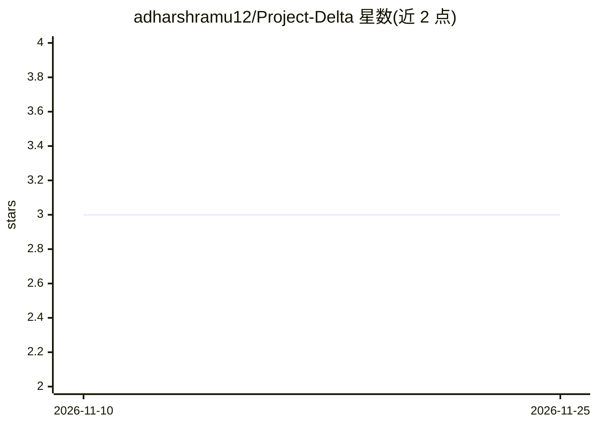

# adharshramu12/Project-Delta

⭐ 3 · Python · AGPL-3.0 · 推送 2026-11-15 · [GitHub](https://github.com/adharshramu12/Project-Delta) · 个人维护

**Windows 上的开源个人 AI agent：用聊天/Telegram 控制电脑和浏览器**

面向 Windows 10/11 个人用户的 AI agent：通过桌面 dashboard 或 Telegram 下达任务，Delta 会规划步骤、像人一样操作本机应用、文件和浏览器，执行前用审批卡片征求许可，完成后核对结果是否达成目标。提供保存登录（DPAPI 加密、验证码处理）、定时 Watchers、附件摘要、65 个应用目录、MCP server 接入、任务历史与撤销、文档生成等。功能锚定 Windows：用 PowerShell 一条命令安装，自带 Python 3.12。

## 筛选速览

| 维度 | 判定 | 备注 |
|---|---|---|
| AI 角色 | `ai-native` | 本体是模型或模型工具 |
| 许可风险 | `viral` | AGPL-3.0 |
| 部署形态 | `desktop` | 安装包/桌面程序 |
| 模型依赖 | local-ok | 支持本地模型 |
| 硬件要求 | — | 无带数字的原话,不猜 |
| 安装摩擦 | `low` | 无编译、无系统依赖或容器化 |
| 成熟度 | — | 结构信号不足 |

## 能力要点

- 每个改动性操作先出审批卡片（Approve/Deny），失败时如实报告
- Telegram 远程操控 PC，支持语音消息与 /命令菜单
- 保存的登录用 Windows DPAPI 加密，不展示给 AI 也不写入日志
- Esc 两次/Ctrl+Alt+Shift+S/手机发 stop 可随时中断控制

## 适用场景

- 在手机上发消息让家里/办公的 PC 执行任务
- 自动登录门户网站并定时查看新通知
- 让 AI 起草邮件并在你批准后才发送
- 用自然语言操作 Notion、Gmail 等已连接应用

## 场景标签

`GUI 自动化` `AI 助手` `浏览器自动化` · 领域:效率与自动化

## 证据(README 行号)

> L7: Delta, an open source AI agent I built that does real work on a Windows PC and checks the result before it says done
> L9: You talk to it in the app on your PC or from Telegram on your phone. It plans the task, uses your apps, files and
> L104: 3. **Set up.** The setup wizard opens: pick your AI, set permissions and pair your Telegram. A short tour of the

## 星数曲线

2026-11-10 3 → 2026-11-25 3（+0）

---
*卡片 v1 · prompt 1.4 · 生成 2026-11-22 · 置信度 high · 依据 README sha `23d7c5a2aa3a` · [字段定义](../../DATASET.md)*
