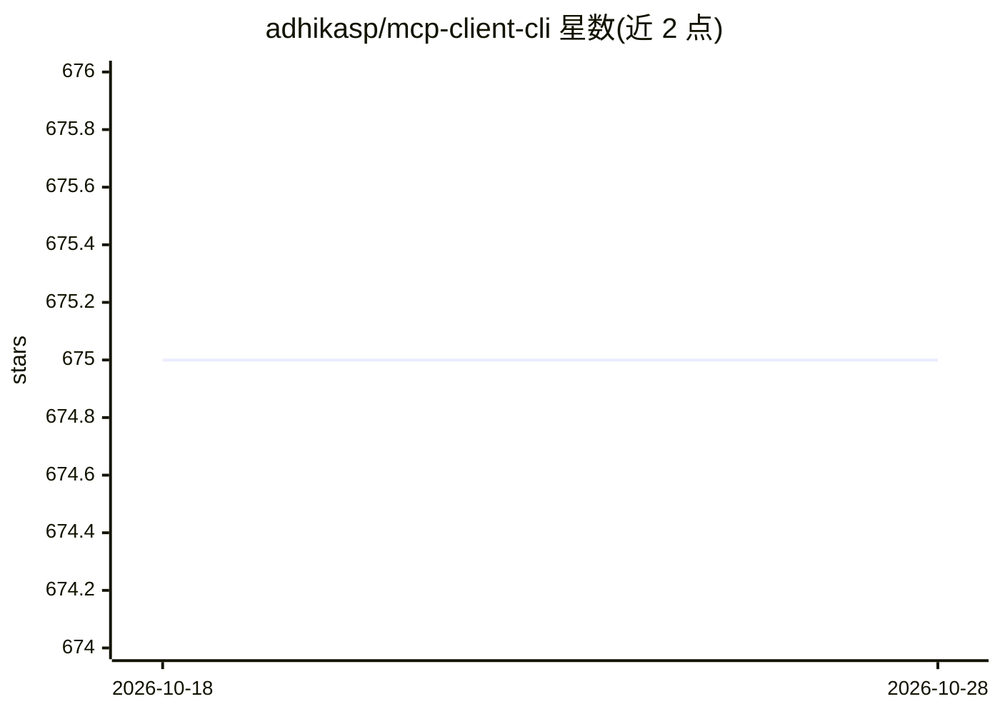

# adhikasp/mcp-client-cli

⭐ 675 · Python · MIT · 推送 2025-12-02 · [GitHub](https://github.com/adhikasp/mcp-client-cli) · 个人维护

**终端里运行 LLM 提示词并连接 MCP 服务器的 CLI 客户端**

用 Python 编写的命令行程序，可在终端向任意 LLM 提问（OpenAI、Groq 或经 llama 使用的本地模型），并作为 Model Context Protocol（MCP）客户端调用任意 MCP 兼容服务器，作为 Claude Desktop 之外的客户端使用。支持管道输入文本与图片（多模态）、提示词模板、工具调用与确认、会话续接（c 前缀）、剪贴板读取及 bash 脚本模式。通过 pip 安装，以 ~/.llm/config.json 配置 LLM 与 MCP 服务器，API key 也可经环境变量注入。剪贴板功能依赖各平台工具（Linux 需 xclip）。

## 筛选速览

| 维度 | 判定 | 备注 |
|---|---|---|
| AI 角色 | `ai-ecosystem` | LLM/agent 周边工具 |
| 许可风险 | `permissive` | MIT |
| 部署形态 | `desktop` | 安装包/桌面程序 |
| 模型依赖 | — | README 未给出锁定关系 |
| 硬件要求 | — | 无带数字的原话,不猜 |
| 安装摩擦 | `low` | 无编译、无系统依赖或容器化 |
| 成熟度 | — | 结构信号不足 |

## 能力要点

- 实现 MCP 客户端，可连接任意 MCP 兼容服务器
- 支持多模态：管道输入图片由多模态 LLM 分析
- 提示词模板、工具调用确认、--no-intermediates 脚本模式
- c 前缀续接上次会话，cb 命令读取剪贴板文本/图片

## 适用场景

- 在终端快速向 LLM 提问并用管道喂入命令输出或文件
- 在 Claude Desktop 之外使用 MCP 服务器的工具能力
- 在 bash 脚本中调用 LLM 并只取最终回答

## 场景标签

`AI 助手` · 领域:对话与助手

## 证据(README 行号)

> L3: A simple CLI program to run LLM prompt and implement Model Context Protocol (MCP) client.
> L5: You can use any MCP-compatible servers from the convenience of your terminal.
> L7: This act as alternative client beside Claude Desktop. Additionally you can use any LLM provider like OpenAI, Groq, o

## 星数曲线

2026-10-18 675 → 2026-10-28 675（+0）

---
*卡片 v1 · prompt 1.4 · 生成 2026-10-21 · 置信度 high · 依据 README sha `831baef6b94b` · [字段定义](../../DATASET.md)*
