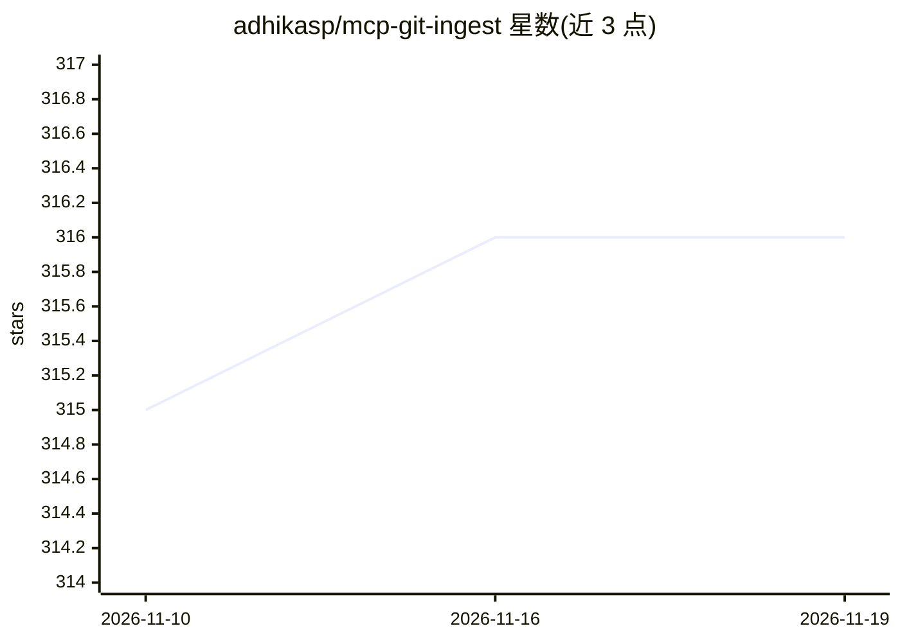

# adhikasp/mcp-git-ingest

⭐ 316 · Python · MIT · 推送 2026-11-10 · [GitHub](https://github.com/adhikasp/mcp-git-ingest) · 个人维护

**供 LLM 读取 GitHub 仓库结构与关键文件的 MCP 服务器**

实现 Model Context Protocol 的服务器，向 MCP 客户端提供两个能力：读取 GitHub 仓库的目录结构（不跟随符号链接）与读取克隆仓库内的重要文件。内置安全限制：拒绝仓库外路径与本地 file:// 克隆、禁访问 .git/、单文件上限 512 KiB（可经 MCP_GIT_INGEST_MAX_FILE_BYTES 覆盖）、可用 MCP_GIT_INGEST_ALLOWED_HOSTS 限制克隆主机。通过 MCP 服务器配置接入，用法示例配合 mcp-client-cli 演示。灵感来自 gitingest。

## 筛选速览

| 维度 | 判定 | 备注 |
|---|---|---|
| AI 角色 | `ai-ecosystem` | LLM/agent 周边工具 |
| 许可风险 | `permissive` | MIT |
| 部署形态 | `None` |  |
| 模型依赖 | — | README 未给出锁定关系 |
| 硬件要求 | — | 无带数字的原话,不猜 |
| 安装摩擦 | `low` | 无编译、无系统依赖或容器化 |
| 成熟度 | — | 结构信号不足 |

## 能力要点

- 提供 git_read_important_files 与 git_directory_structure 两类 MCP 工具
- 路径校验拒绝越界路径、符号链接逃逸与 file:// 克隆地址
- 单文件 512 KiB 上限与允许主机白名单可经环境变量配置

## 适用场景

- 让 LLM 客户端获取 GitHub 仓库的目录结构与关键文件内容
- 在 MCP 客户端中分析开源仓库的实现方式

## 场景标签

`Agent 框架` · 领域:Agent 开发

## 证据(README 行号)

> L4: A Model Context Protocol (MCP) server that helps read GitHub repository structure and important files.
> L33: Using mcp-client-cli:

## 星数曲线

2026-11-10 315 → 2026-11-19 316（+1）

---
*卡片 v1 · prompt 1.4 · 生成 2026-11-17 · 置信度 high · 依据 README sha `789e711af2ad` · [字段定义](../../DATASET.md)*
