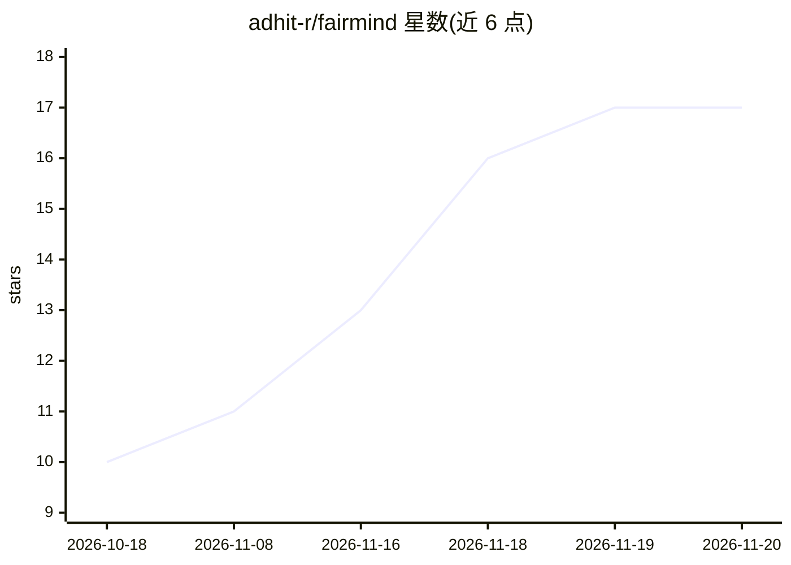

# adhit-r/fairmind

⭐ 17 · Python · AGPL-3.0 · 推送 2026-11-19 · [GitHub](https://github.com/adhit-r/fairmind) · [官网](https://www.fairmind.xyz) · 个人维护

**开源 AI 治理平台：以工作流评估 AI 系统并产出审计证据**

面向需要治理 LLM 应用与 AI agent 的团队：以工作流（收集、检查、建议、人工决策、验证、归档）运行治理流程，agent 起草步骤、人在每个门禁处决定，每步落入哈希链账本。提供 109 项评估（上传文件、探测在线系统、检查 agent 平台配置）、五项检查的发布门禁，并把 51 个框架（ISO/IEC 42001、NIST AI RMF、EU AI Act 等）经通用控制映射到一次运行。带 CLI、Python SDK、MCP server 与 GitHub Action。Alpha 阶段：86/90 工作流标记为 proposed，不做合规认证，不进入请求路径。

## 筛选速览

| 维度 | 判定 | 备注 |
|---|---|---|
| AI 角色 | `ai-ecosystem` | LLM/agent 周边工具 |
| 许可风险 | `dual` | AGPL-3.0 |
| 部署形态 | `library` | 以包/库形式分发 |
| 模型依赖 | — | README 未给出锁定关系 |
| 硬件要求 | — | 无带数字的原话,不猜 |
| 安装摩擦 | `low` | 无编译、无系统依赖或容器化 |
| 成熟度 | `idea` | |

## 能力要点

- 51 个框架经 29 个通用控制映射，一次运行计入多个框架证据
- 哈希链账本记录每步决策与证据，支持离线验证导出包
- 109 项评估覆盖偏见、提示注入、越狱、数据漂移、agent 配置风险等
- 提供 CLI、Python SDK、MCP server（9 个工具）与 GitHub Action

## 适用场景

- 团队在发布前跑公平性、安全等评估并通过门禁决定 go/no_go
- 为 ISO 42001 / NIST AI RMF / EU AI Act 审计准备可验证证据包
- 在 CI 中读取发布门禁结果作为测试环节
- 对 agent 平台配置做 MCP 服务器与工具风险检查

## 场景标签

`模型评测` · 领域:评测与运维

## 证据(README 行号)

> L22: FairMind governs AI systems, including LLM applications and AI agents, by running governance as **workflows**. Each
> L45: |**Release gate**|Five checks (fairness, data governance, human oversight, monitoring, environmental) give `go`, `c
> L48: |**CI and agents**|CLI, GitHub Action, Python SDK and MCP server read the gate and push test results with an API ke

## 星数曲线

2026-10-18 10 → 2026-11-20 17（+7）

---
*卡片 v1 · prompt 1.4 · 生成 2026-11-18 · 置信度 high · 依据 README sha `227fc4cf81b3` · [字段定义](../../DATASET.md)*
