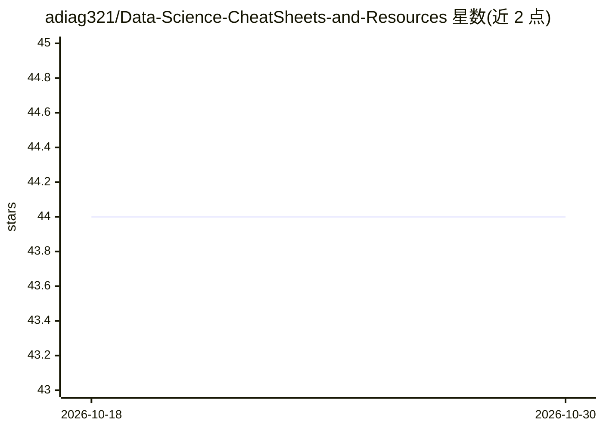

# adiag321/Data-Science-CheatSheets-and-Resources

⭐ 44 · MIT · 推送 2026-09-15 · [GitHub](https://github.com/adiag321/Data-Science-CheatSheets-and-Resources) · 个人维护

**数据科学学习资源清单：SQL/Python/ML/MLOps 等教程与面试资料**

个人维护的数据科学学习资源合集：按 YouTubers、SQL、Python、概率统计、机器学习算法（回归、决策树、KNN、SVM、聚类、PCA 等）、LangChain、MLOps、书籍、案例研究与系统设计分章节组织，条目为 YouTube 频道/播放列表、文章、教程、面试准备资料与项目案例。覆盖从入门练习到企业级面试题（Lyft/Uber、Visa、Airbnb 等）。资源为链接汇总形式，不含可运行代码。

## 筛选速览

| 维度 | 判定 | 备注 |
|---|---|---|
| AI 角色 | `ai-knowledge` | 知识聚合/清单类 |
| 许可风险 | `permissive` | MIT |
| 部署形态 | `None` |  |
| 模型依赖 | — | README 未给出锁定关系 |
| 硬件要求 | — | 无带数字的原话,不猜 |
| 安装摩擦 | `low` | 无编译、无系统依赖或容器化 |
| 成熟度 | — | 结构信号不足 |

## 能力要点

- 覆盖 SQL、Python、统计、ML 算法、MLOps、LangChain 等 9 大类资源
- 按算法主题细分（线性/逻辑回归、树模型、SVM、聚类、PCA、时序等）
- 含面试准备与企业案例研究（Lyft/Uber、Visa、Airbnb）

## 适用场景

- 系统查找数据科学各主题的学习视频与文章
- 准备数据科学/机器学习面试
- 查阅企业数据科学案例与 ML 系统设计资料

## 场景标签

`精选清单` `教程课程` · 领域:学习与行业

## 证据(README 行号)

> L2: In this repository, I have curated all the materials one can use to study SQL, Data Analysis, Statistics, Machine le
> L4: ### Table of Contents

## 星数曲线

2026-10-18 44 → 2026-10-30 44（+0）

---
*卡片 v1 · prompt 1.4 · 生成 2026-10-25 · 置信度 high · 依据 README sha `cd8c22603096` · [字段定义](../../DATASET.md)*
