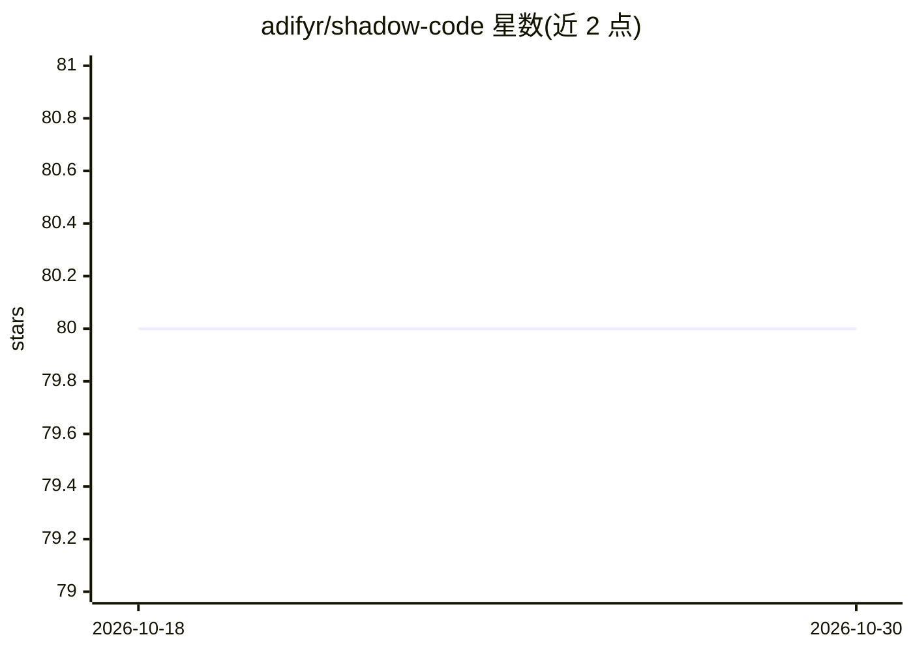

# adifyr/shadow-code

⭐ 80 · TypeScript · GPL-3.0 · 推送 2026-03-12 · [GitHub](https://github.com/adifyr/shadow-code) · 个人维护

**VS Code/Cursor 扩展：用伪代码提示让 AI 生成目标语言代码**

Shadow Code 是一个免费开源的 VS Code 与 Cursor 扩展，实现所谓 Shadow Coding 技术：开发者在并行分屏的 .shadow 文件中写伪代码而非自然语言，触发转换后由 AI 模型在原代码文件中生成目标语言代码。通过 VS Code 原生 Language Models API 工作，需模型提供方（如 GitHub Copilot）才能运行。支持 context() 函数选择性传入上下文文件、自动安装生成代码的缺失依赖、自动读取 pubspec.yaml/package.json，并可用 .skills/ 目录为语言添加自定义指令；对 7 种语言提供一等支持（含自动装依赖）。

## 筛选速览

| 维度 | 判定 | 备注 |
|---|---|---|
| AI 角色 | `ai-native` | 本体是模型或模型工具 |
| 许可风险 | `viral` | GPL-3.0 |
| 部署形态 | `None` |  |
| 模型依赖 | — | README 未给出锁定关系 |
| 硬件要求 | — | 无带数字的原话,不猜 |
| 安装摩擦 | `low` | 无编译、无系统依赖或容器化 |
| 成熟度 | `idea` | |

## 能力要点

- 伪代码→目标语言代码的分屏转换工作流
- context() 函数控制模型可见的上下文文件
- 自动安装生成代码的缺失依赖
- 7 种语言一等支持，.skills/ 可扩展语言指令

## 适用场景

- 用伪代码代替自然语言提示生成确定性更高的代码
- 为缺失的语言特性（如 Dart 数据类）自定义 shadow 语法
- 复用重复样板代码的模板化生成

## 场景标签

`代码生成` · 领域:编码与开发

## 证据(README 行号)

> L17: Shadow Coding TM is an AI coding technique that involves transforming human-written pseudocode to clean, accurate &
> L67: Shadow Code will generate the target code in your original code file:

## 星数曲线

2026-10-18 80 → 2026-10-30 80（+0）

---
*卡片 v1 · prompt 1.4 · 生成 2026-10-24 · 置信度 high · 依据 README sha `5f31871960db` · [字段定义](../../DATASET.md)*
