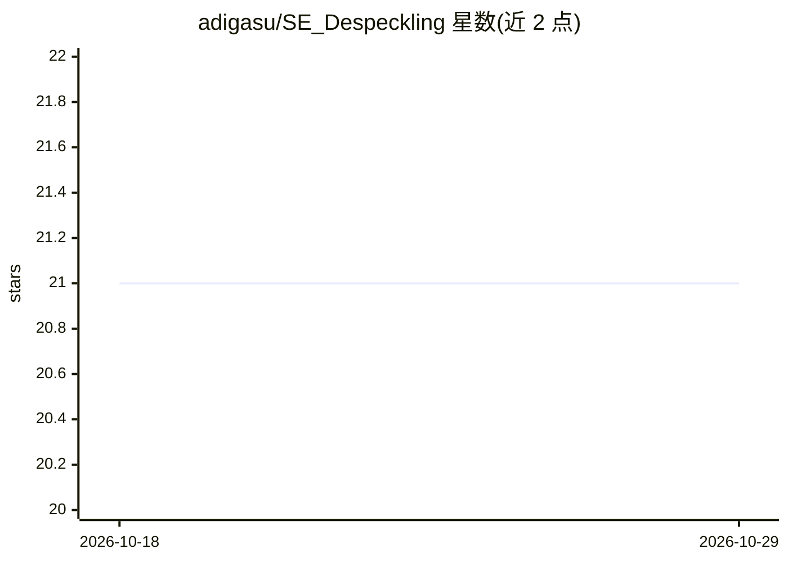

# adigasu/SE_Despeckling

⭐ 21 · Python · MIT · 推送 2026-08-24 · [GitHub](https://github.com/adigasu/SE_Despeckling) · 个人维护

**基于共享编码器的 OCT 图像去散斑 CNN 方法（ICVGIP 2018 论文代码）**

ICVGIP 2018 论文的官方代码实现：提出 Shared Encoder (SE) 架构，由两个共享编码器层的自编码器组成，用非配对的含噪与干净 OCT 图像进行无监督端到端训练，通过跨模型预测得到去噪图像，声称可适用于任意扫描仪的含/不含病理 OCT 图像。依赖 Keras/keras_contrib/Theano（Python 2.7-3.5），提供训练与测试脚本及预训练权重（SE 与微调版 SSE1）。

## 筛选速览

| 维度 | 判定 | 备注 |
|---|---|---|
| AI 角色 | `ai-native` | 本体是模型或模型工具 |
| 许可风险 | `permissive` | MIT |
| 部署形态 | `None` |  |
| 模型依赖 | — | README 未给出锁定关系 |
| 硬件要求 | — | 无带数字的原话,不猜 |
| 安装摩擦 | `low` | 无编译、无系统依赖或容器化 |
| 成熟度 | — | 结构信号不足 |

## 能力要点

- 双自编码器共享编码层的 SE 架构，非配对非监督训练
- 跨模型预测生成去噪 OCT 图像
- 提供 SE 与 SSE1 预训练权重
- 提供 train_SE.py / test_SE.py 复现脚本

## 适用场景

- 复现论文的去噪实验结果
- 对 OCT 图像执行 CNN 去散斑处理
- 作为非配对图像去噪研究的代码参考

## 场景标签

`图像视频处理` · 领域:感知与多模态

## 证据(README 行号)

> L3: OCT images are corrupted by speckle noise due to the underlying coherence-based strategy. Speckle suppression/remova
> L4: to reconstruct noisy and clean OCT images with respective autoencoders. The denoised OCT image is obtained using a c

## 星数曲线

2026-10-18 21 → 2026-10-29 21（+0）

---
*卡片 v1 · prompt 1.4 · 生成 2026-10-28 · 置信度 high · 依据 README sha `564de4f11b10` · [字段定义](../../DATASET.md)*
