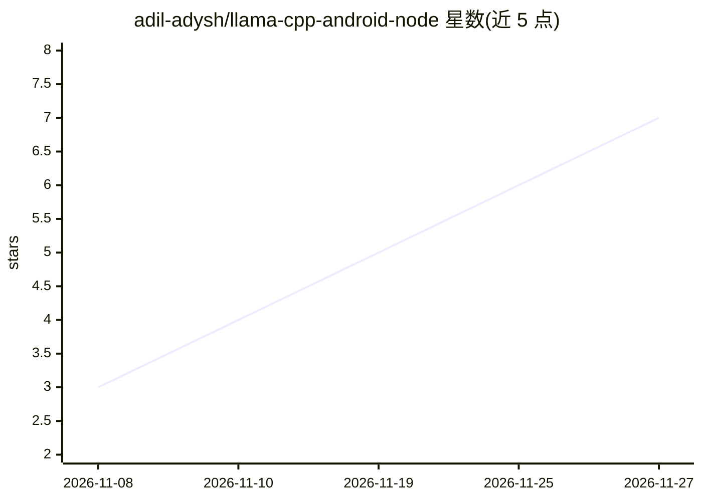

# adil-adysh/llama-cpp-android-node

⭐ 7 · Kotlin · 推送 2026-10-14 · [GitHub](https://github.com/adil-adysh/llama-cpp-android-node) · 个人维护

**把 Android 手机变成 llama.cpp 分布式推理 RPC 节点**

一个 Android 应用，将 llama.cpp 的 ggml-rpc-server 以前台服务形式在手机后台运行，使手机可作为 PC/服务器集群的分布式推理节点。支持 Vulkan GPU 与 ARM CPU（OpenMP/Neon/DotProd）双计算后端并自动选择，可通过 Wi-Fi（0.0.0.0）或 USB ADB 端口转发连接 Windows 主机，支持逗号分隔端点的多手机集群分片。提供 Jetpack Compose 界面、本地 IP 自动发现与日志查看。内置二进制基于 llama.cpp b11429 用 Android NDK r28 交叉编译，并附验证设备的基准数据。

## 筛选速览

| 维度 | 判定 | 备注 |
|---|---|---|
| AI 角色 | `ai-ecosystem` | LLM/agent 周边工具 |
| 许可风险 | `none` | — |
| 部署形态 | `desktop` | 安装包/桌面程序 |
| 模型依赖 | local-ok | 支持本地模型 |
| 硬件要求 | — | 无带数字的原话,不猜 |
| 安装摩擦 | `low` | 无编译、无系统依赖或容器化 |
| 成熟度 | — | 结构信号不足 |

## 能力要点

- Vulkan GPU 与 ARM CPU 双计算后端，自动选择并回退
- Wi-Fi 或 USB (ADB) 连接主机，支持多手机集群分片
- 前台服务含 WakeLock/WifiLock，符合 Android 10+ SELinux W^X 策略
- 预编译原生二进制（NDK r28, arm64-v8a）可一键部署

## 适用场景

- 把闲置 Android 手机作为本地 llama.cpp 集群的算力节点
- 通过 USB 连接手机为 PC 大模型推理卸载部分层
- 多台手机组网做分片式分布式推理

## 场景标签

`推理引擎` · 领域:训练与推理

## 证据(README 行号)

> L5: `llama-cpp-android-node` is a high-performance Android application that runs `llama.cpp`'s `ggml-rpc-server` as a pe
> L13:  - 🔀 **Multi-Device Cluster:** Run multiple phones concurrently by passing comma-separated RPC endpoints.

## 星数曲线

2026-11-08 3 → 2026-11-27 7（+4）

---
*卡片 v1 · prompt 1.4 · 生成 2026-11-21 · 置信度 high · 依据 README sha `222c94fe9332` · [字段定义](../../DATASET.md)*
