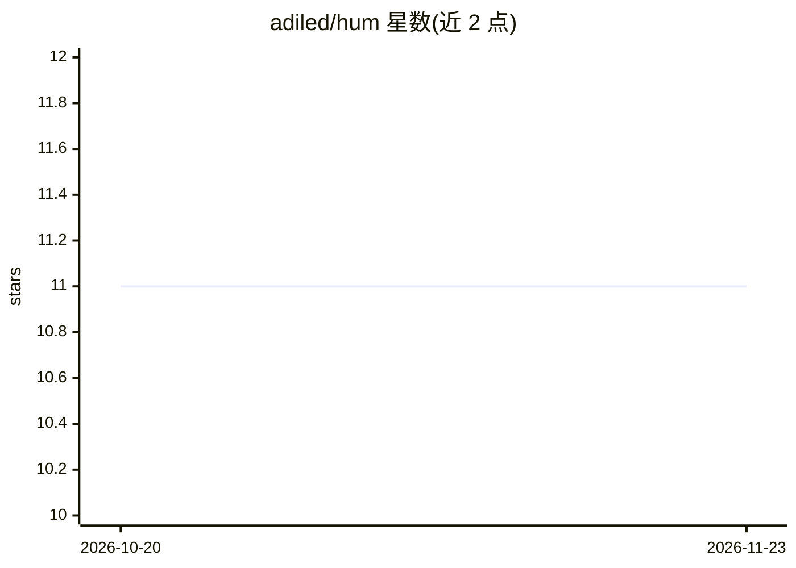

# adiled/hum

⭐ 11 · Rust · MIT · 推送 2026-11-22 · [GitHub](https://github.com/adiled/hum) · [官网](https://adiled.github.io/hum) · 个人维护

**自称为 agentic 内核框架的 AI 系统，用于分布式 agent 协作**

以 Rust 实现的框架，自称 agentic kernel：通过 humd 节点与 bee/hive 等原语组织多机协作，每次对话可从不同节点获取推理、计算、文件系统与 UX 能力，节点间以 thrum 协议与 gossip 机制通信，无需中央调度。提供 hum-nest、openai-server 兼容 API、TUI 等组件，配置文件位于 ~/.config/hum/hum.json。README 附有与 LiteLLM、Ollama、vLLM、CAMEL 等产品的能力对比表，明确表示非 LLM router。安装通过 curl 脚本完成。

## 筛选速览

| 维度 | 判定 | 备注 |
|---|---|---|
| AI 角色 | `ai-ecosystem` | LLM/agent 周边工具 |
| 许可风险 | `permissive` | MIT |
| 部署形态 | `None` |  |
| 模型依赖 | — | README 未给出锁定关系 |
| 硬件要求 | — | 无带数字的原话,不猜 |
| 安装摩擦 | `low` | 无编译、无系统依赖或容器化 |
| 成熟度 | `idea` | |

## 能力要点

- bee/hive/nest/thrum/petal/bloom 等自述原语构成 agentic 内核
- ensemble mesh：推理、计算、文件系统、UX 在不同节点间解耦协作
- 提供 OpenAI 兼容 API（openai-server hive）与内置 TUI
- 含信任分级（T1→T4）、零信任访问控制与哈希链共识机制描述

## 适用场景

- 搭建多节点分布式 agent 协作环境
- 通过 OpenAI 兼容 API 接入自有工作流
- 构建去中心化的 agent 能力交换网络

## 场景标签

`多智能体` `Agent 框架` · 领域:Agent 开发

## 证据(README 行号)

> L29: An ensemble is a mesh of cooperating humds, where bees gossip like a hive trading news of distant blossoms. A singl
> L41: > hum is an agentic kernel, not an LLM router, and incomparable in scope. This table simply highlights

## 星数曲线

2026-10-20 11 → 2026-11-23 11（+0）

---
*卡片 v1 · prompt 1.4 · 生成 2026-11-18 · 置信度 mid · 依据 README sha `f7a3075f9c39` · [字段定义](../../DATASET.md)*
