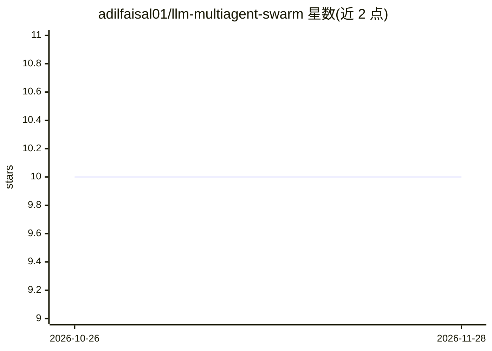

# adilfaisal01/llm-multiagent-swarm

⭐ 10 · Python · Apache-2.0 · 推送 2026-11-01 · [GitHub](https://github.com/adilfaisal01/llm-multiagent-swarm) · 个人维护

**基于 Ollama 云端模型的多智能体研究编排工具**

用 Ollama 云端模型做多智能体研究编排：编排者 LLM 分析问题，为并行运行的 worker 分配技能包与研究角度，各 worker 通过网络搜索、图像读取、代码执行、文件读取等工具独立调研，结论写入共享只写暂存区；编排者随后读取暂存区、做来源去重与可信度评分，生成带引用的回答并保存为带时间戳的 Markdown 文件。核心库仅用 Python 标准库，TUI 为可选组件，网络搜索默认走 DuckDuckGo 无需 API key。

## 筛选速览

| 维度 | 判定 | 备注 |
|---|---|---|
| AI 角色 | `ai-ecosystem` | LLM/agent 周边工具 |
| 许可风险 | `permissive` | Apache-2.0 |
| 部署形态 | `library` | 以包/库形式分发 |
| 模型依赖 | local-ok | 支持本地模型 |
| 硬件要求 | — | 无带数字的原话,不猜 |
| 安装摩擦 | `low` | 无编译、无系统依赖或容器化 |
| 成熟度 | — | 结构信号不足 |

## 能力要点

- 编排者分配技能包与角度，支持并行/流水线两种执行模式
- 只写共享暂存区 + 来源去重与可信度评分
- 工具含网络搜索、图像读取、代码执行、文件读取
- MCP server 形式可接入 Claude Desktop / Cursor / opencode

## 适用场景

- 对一个问题从多个研究角度并行调研并汇总成带引用的报告
- 接入 Claude Desktop / Cursor 等客户端作为 swarm_research 工具
- 按环境变量或 JSON 配置自定义模型、团队与搜索后端

## 场景标签

`多智能体` `科研工具` · 领域:Agent 开发

## 证据(README 行号)

> L3: Multi-agent research orchestration using Ollama cloud models. Spawn parallel workers with focused research angles, e
> L26: The orchestrator LLM (DeepSeek V4 Flash) analyzes your question, assigns each
> L46: |docs/MCP.md|MCP server (`swarm_research` tool for Claude Desktop / Cursor / opencode)|

## 星数曲线

2026-10-26 10 → 2026-11-28 10（+0）

---
*卡片 v1 · prompt 1.4 · 生成 2026-11-20 · 置信度 high · 依据 README sha `ec975eae4ba6` · [字段定义](../../DATASET.md)*
