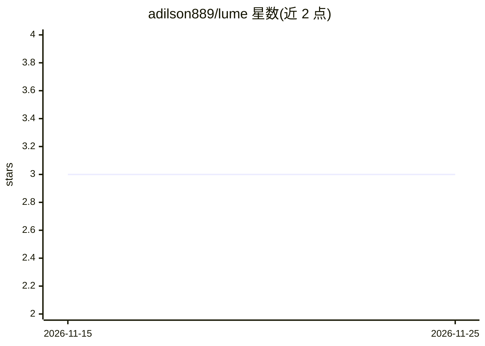

# adilson889/lume

⭐ — · [GitHub]() · 个人维护

**基于规则、可由人类教学增长的葡萄牙语聊天机器人**

Lume 是一个以 BotQL 声明式规则语言编写的会话机器人，明确声明不是训练的语言模型。消息先经 NLP.js（内嵌单文件 127 KB，页面打开时用 intencoes.txt 训练）做意图分类，再按查询链依次查已学知识文件、多项答案投票、求助或兜底回答。用户可通过正负评价教授新答案，内容经管理面板审核批准后才进入知识库；知识增长靠收集、验证与持久化，不自动修改自身参数。以静态页面运行，需经 HTTP 服务，不支持直接打开文件。

## 筛选速览

| 维度 | 判定 | 备注 |
|---|---|---|
| AI 角色 | `ai-enhanced` | 去掉 AI 部分产品仍成立 |
| 许可风险 | `permissive` | — |
| 部署形态 | `None` |  |
| 模型依赖 | — | README 未给出锁定关系 |
| 硬件要求 | — | 无带数字的原话,不猜 |
| 安装摩擦 | `low` | 无编译、无系统依赖或容器化 |
| 成熟度 | `idea` | |

## 能力要点

- BotQL 规则引擎驱动，非语言模型
- NLP.js 意图分类（页面打开时训练）
- 用户教学 + 审核面板的知识收集与验证机制
- 静态页面部署，本地经 HTTP 服务运行

## 适用场景

- 搭建可由社区/用户逐步教授知识的问答机器人
- 需要人工审核学习内容的客服或咨询场景
- 规则驱动的葡萄牙语聊天机器人示例参考

## 场景标签

`聊天机器人` · 领域:对话与助手

## 证据(README 行号)

> L18: O Lume é um **BOT conversacional**, desenvolvido integralmente com BotQL, uma linguagem declarativa baseada em regr
> L40: O chat utiliza NLP.js, incluído num único ficheiro (`LUME/vendor/nlp.min.js`, 127 KB), para classificar as mensagen
> L52: Este mecanismo representa aprendizagem por recolha, validação e persistência de conhecimento. Não significa que o b

## 星数曲线

2026-11-15 3 → 2026-11-25 3（+0）

---
*卡片 v1 · prompt 1.4 · 生成 2026-11-22 · 置信度 mid · 依据 README sha `60160f7ff23e` · [字段定义](../../DATASET.md)*
