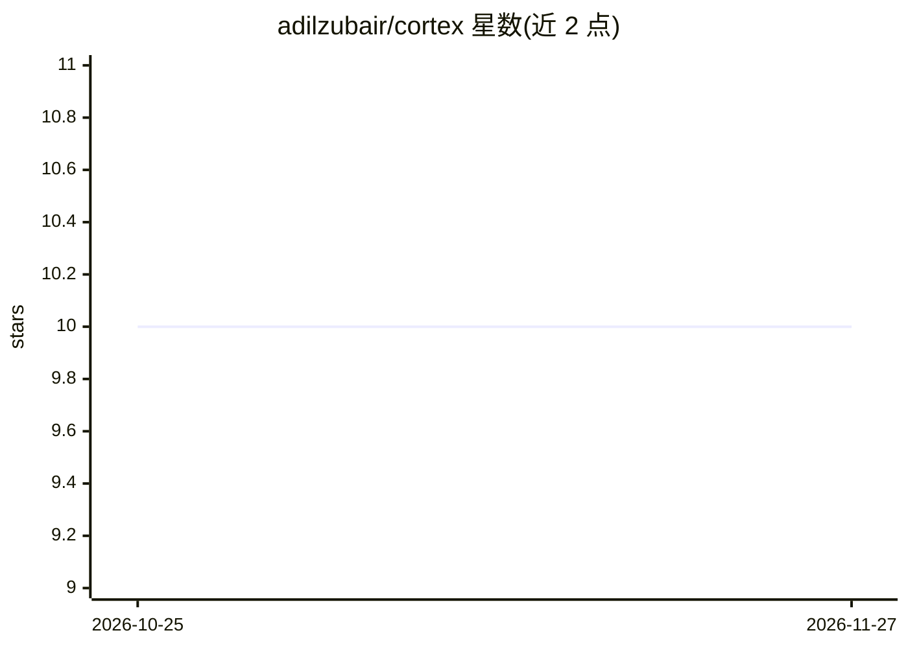

# adilzubair/cortex

⭐ 10 · Python · 推送 2026-05-29 · [GitHub](https://github.com/adilzubair/cortex) · 个人维护

**本地运行的开发者代码库问答助手（RAG+多智能体）**

面向开发者的代码库问答 CLI 工具：对项目做分块、向量索引（ChromaDB + qwen3 嵌入），结合 Jedi LSP 静态分析与语义检索，通过 LangGraph 驱动的 ReAct 多智能体（Explorer/Builder/Planner/General 子代理）回答代码问题。支持 SHA-256 增量索引、watchdog 文件监控自动重建索引、多项目隔离、GitHub 仓库直接克隆索引，以及 Rich 终端交互式聊天与会话记忆。默认经 Ollama 全本地运行，也可切换 CLIproxyAPI 或 OpenAI 兼容端点；Python 静态分析限定 Python 项目。

## 筛选速览

| 维度 | 判定 | 备注 |
|---|---|---|
| AI 角色 | `ai-native` | 本体是模型或模型工具 |
| 许可风险 | `permissive` | — |
| 部署形态 | `None` |  |
| 模型依赖 | local-ok | 支持本地模型 |
| 硬件要求 | — | 无带数字的原话,不猜 |
| 安装摩擦 | `low` | 无编译、无系统依赖或容器化 |
| 成熟度 | — | 结构信号不足 |

## 能力要点

- 多智能体 ReAct 编排：Explorer/Builder/Planner/General 四类子代理
- LSP（Jedi）符号级检索 + 语义搜索 + rerank 的混合查询
- SHA-256 增量索引与 watchdog 实时文件监控
- 默认 Ollama 本地运行，代码不出本机

## 适用场景

- 接手新团队时快速理解大型代码库的架构与逻辑
- 排查 bug 时定位支付等业务相关代码和引用关系
- 为索引系统等模块生成文档级解释与代码片段
- 重构前查找某个类的全部依赖与引用位置

## 场景标签

`RAG` `语义搜索` `多智能体` `文档问答` · 领域:Agent 开发

## 证据(README 行号)

> L16: **Cortex** is a sophisticated AI coding assistant that combines the power of **Retrieval-Augmented Generation (RAG)
> L45: - **LangGraph-based ReAct agents** for multi-step reasoning
> L74: - **Local Models**: Optimized for `ministral-3:3b` + `qwen3-embedding:0.6b` via Ollama

## 星数曲线

2026-10-25 10 → 2026-11-27 10（+0）

---
*卡片 v1 · prompt 1.4 · 生成 2026-11-20 · 置信度 high · 依据 README sha `fc6c4fdaa678` · [字段定义](../../DATASET.md)*
