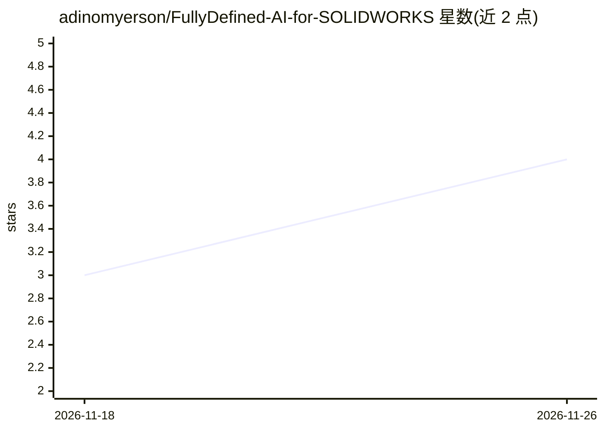

# adinomyerson/FullyDefined-AI-for-SOLIDWORKS

⭐ 4 · Python · MIT · 推送 2026-11-14 · [GitHub](https://github.com/adinomyerson/FullyDefined-AI-for-SOLIDWORKS) · 个人维护

**SOLIDWORKS 的 MCP 服务器：让 AI 应用按设计意图生成零件**

通过 MCP 协议向 Claude Desktop、Claude Code、Antigravity 等 AI 应用暴露 121 个工具，覆盖零件建模、钣金、焊件、装配、工程图与 STEP/STL/PDF 导出，使 AI 依据用户描述或图纸在本地 SOLIDWORKS 中生成完全定义的模型。每次操作后回读体积、质量、距离与草图状态以核对结果。以 Windows 安装包分发，无需 Python 或 Git，要求 SOLIDWORKS 2022 及以上。

## 筛选速览

| 维度 | 判定 | 备注 |
|---|---|---|
| AI 角色 | `ai-ecosystem` | LLM/agent 周边工具 |
| 许可风险 | `permissive` | MIT |
| 部署形态 | `desktop` | 安装包/桌面程序 |
| 模型依赖 | — | README 未给出锁定关系 |
| 硬件要求 | — | 无带数字的原话,不猜 |
| 安装摩擦 | `low` | 无编译、无系统依赖或容器化 |
| 成熟度 | — | 结构信号不足 |

## 能力要点

- 121 个工具覆盖零件、钣金、焊件、装配、工程图到导出
- 每步回读模型测量数据（体积/质量/距离/草图状态）
- Windows 安装包一键安装，自动勾选接入 AI 应用
- 修改前复制文件，不自动保存用户文件，支持保护文件夹

## 适用场景

- 用自然语言描述让 AI 在 SOLIDWORKS 中建模
- 给 AI 一张图纸让它按图生成完全定义的零件
- 从草图到带 BOM 的工程图全流程由 AI 驱动

## 场景标签

 · 领域:CAD/机械工程工具

## 证据(README 行号)

> L3: **Tell your AI app what to build. It builds it in SOLIDWORKS, fully defined and measured, and you keep working on it
> L15: - **121 tools.** Parts, sheet metal, weldments, assemblies, drawings and export, from a first sketch to a drawing w
> L51: - **Tested:** Claude Desktop and Claude Code, with Claude Opus and Claude Sonnet.

## 星数曲线

2026-11-18 3 → 2026-11-26 4（+1）

---
*卡片 v1 · prompt 1.4 · 生成 2026-11-22 · 置信度 high · 依据 README sha `ffcb44c0c0e3` · [字段定义](../../DATASET.md)*
