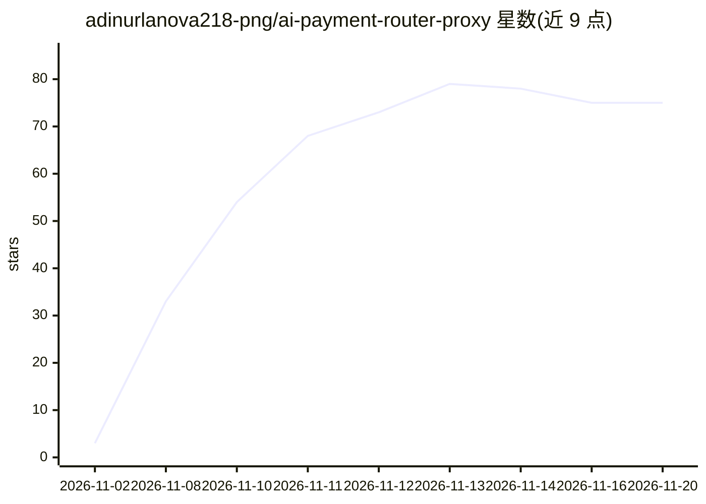

# adinurlanova218-png/ai-payment-router-proxy

⭐ 75 · 推送 2026-11-02 · [GitHub](https://github.com/adinurlanova218-png/ai-payment-router-proxy) · [官网](https://app.coregold.io/signup?invite_code=ADvlj9b) · 个人维护 · 中文 README

**面向开发者的 AI API 支付扣费避坑指南文档**

仓库内容为一篇中文指南，讨论 2026 年前后使用深度推理模型与自主 Agent 时支付链路遇到的问题：Anthropic 幽灵退款与连坐封号、高频并发预授权触发锁卡、Agent 死循环导致连续扣款，并对比收单网关的交互差异。README 可见部分为问题分析文字与部分代码片段，未见本产品本身的安装命令、运行方式或功能代码说明，页面带 coregold 主题标签。

## 筛选速览

| 维度 | 判定 | 备注 |
|---|---|---|
| AI 角色 | `ai-knowledge` | 知识聚合/清单类 |
| 许可风险 | `none` | — |
| 部署形态 | `None` |  |
| 模型依赖 | — | README 未给出锁定关系 |
| 硬件要求 | — | 无带数字的原话,不猜 |
| 安装摩擦 | `low` | 无编译、无系统依赖或容器化 |
| 成熟度 | — | 结构信号不足 |

## 能力要点

- 梳理三类 AI API 扣费风险场景（封号、锁卡、死循环扣款）
- 对比不同卡种在收单网关（Stripe Payment Intents）的通过情况

## 适用场景

- 遇到 AI API 充值退款或封号时查阅原因分析
- 了解自动化 Agent 高频预授权触发锁卡的机制

## 场景标签

`教程课程` · 领域:学习与行业

## 证据(README 行号)

> L2: ⚡ 别让支付打断生产力：AI API 与自动化 Agent 扣费避坑指南
> L6: 2026 年底深度推理模型（o1/o3-mini、Claude 3.7 Sonnet）与自主 Agent 全面铺开，开发者面临的最大瓶颈往往不是 Token 消耗，而是支付链路上的底层阻断：

## 星数曲线

2026-11-02 3 → 2026-11-20 75（+72）

---
*卡片 v1 · prompt 1.4 · 生成 2026-11-18 · 置信度 mid · 依据 README sha `432d7e8d70b4` · [字段定义](../../DATASET.md)*
