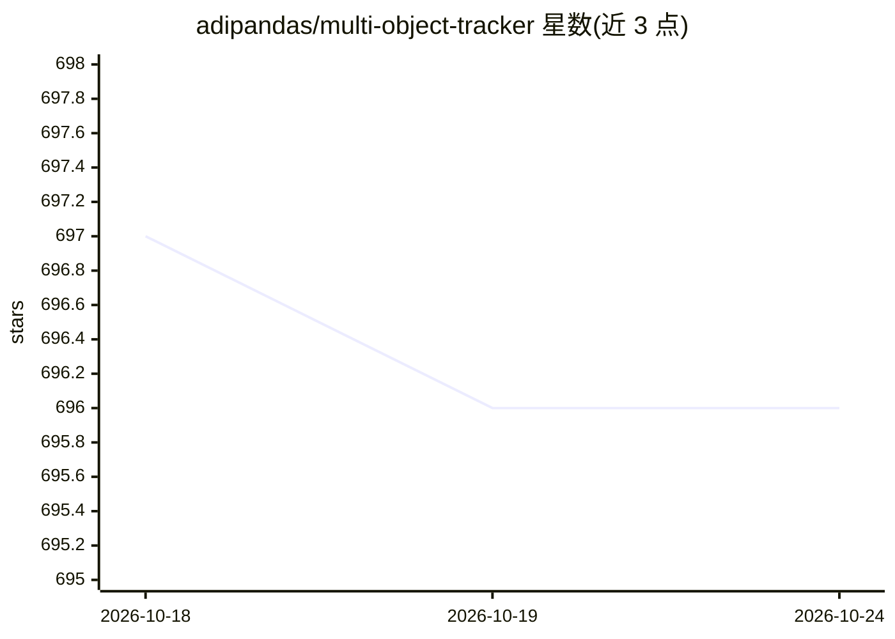

# adipandas/multi-object-tracker

⭐ 696 · Python · MIT · 推送 2026-07-17 · [GitHub](https://github.com/adipandas/multi-object-tracker) · [官网](https://adipandas.github.io/multi-object-tracker/) · 个人维护

**Python 多目标跟踪库：提供多种跟踪器与检测器接口**

以 Python 包（motrackers）形式实现多种多目标跟踪算法，包括 CentroidTracker、IOUTracker、CentroidKF_Tracker 与 SORT；内置基于 OpenCV dnn 的目标检测器封装（TF-MobileNetSSD、Caffe-MobileNetSSD、YOLOv3），需自行下载预训练权重。供计算机视觉开发者以统一接口在视频流上做目标检测与跟踪；GPU 推理可能需自行编译 CUDA 版 OpenCV。支持 pip 与源码安装，附示例与测试套件。

## 筛选速览

| 维度 | 判定 | 备注 |
|---|---|---|
| AI 角色 | `ai-native` | 本体是模型或模型工具 |
| 许可风险 | `permissive` | MIT |
| 部署形态 | `library` | 以包/库形式分发 |
| 模型依赖 | — | README 未给出锁定关系 |
| 硬件要求 | — | 无带数字的原话,不猜 |
| 安装摩擦 | `medium` | 含编译或系统依赖之一 |
| 成熟度 | — | 结构信号不足 |

## 能力要点

- 4 种跟踪算法：CentroidTracker / IOUTracker / CentroidKF_Tracker / SORT
- 内置 OpenCV dnn 检测器：TF-MobileNetSSD、Caffe-MobileNetSSD、YOLOv3
- 提供预训练权重下载脚本与统一易用的跟踪器接口

## 适用场景

- 在视频中对车辆、动物等目标做检测与跟踪
- 以统一接口快速切换不同多目标跟踪算法
- 作为多目标跟踪算法的参考实现与二次开发基础

## 场景标签

`目标检测` · 领域:感知与多模态

## 证据(README 行号)

> L13: - CentroidTracker
> L20: - detector.TF_SSDMobileNetV2

## 星数曲线

2026-10-18 697 → 2026-10-24 696（-1）

---
*卡片 v1 · prompt 1.4 · 生成 2026-10-21 · 置信度 high · 依据 README sha `d37d051ca92d` · [字段定义](../../DATASET.md)*
