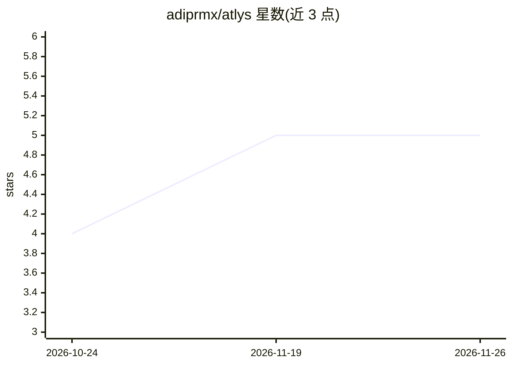

# adiprmx/atlys

⭐ 5 · JavaScript · MIT · 推送 2026-11-17 · [GitHub](https://github.com/adiprmx/atlys) · 个人维护

**为 AI 编码 agent 提供 47 个设计/写作/工程技能的清单**

以 SKILL.md + skill.yaml 组织的技能集合，分设计（17）、写作（12）、工程（18）三类，用户通过 npx 或 git clone 将技能文件夹复制到 agent 的 skills 目录（如 ~/.claude/skills/），agent 在任务匹配时读取并应用。部分技能含辅助脚本；条目多改编自其他开源项目并保留原许可。支持 sparse-checkout 按类别取用，提供 skills.json 与 llms.txt 机器可读索引。

## 筛选速览

| 维度 | 判定 | 备注 |
|---|---|---|
| AI 角色 | `ai-knowledge` | 知识聚合/清单类 |
| 许可风险 | `permissive` | MIT |
| 部署形态 | `self-host` | docker 或自建部署 |
| 模型依赖 | — | README 未给出锁定关系 |
| 硬件要求 | — | 无带数字的原话,不猜 |
| 安装摩擦 | `low` | 无编译、无系统依赖或容器化 |
| 成熟度 | — | 结构信号不足 |

## 能力要点

- 47 个技能覆盖设计、写作、工程三类
- SKILL.md frontmatter 支持自动索引与加载
- npx / git clone / sparse-checkout 多种获取方式
- 提供 skills.json 与 llms.txt 机器可读索引

## 适用场景

- 为 Claude Code 或 Cursor 安装前端设计与写作技能
- 给编码 agent 配置无障碍检查与代码质量规则
- 按类别只取需要的技能子集

## 场景标签

`提示工程` · 领域:Agent 开发

## 证据(README 行号)

> L1: atlys — a curated collection of skills for AI coding agents
> L44: Then tell your agent to load the skill when relevant — or wire it into your agent's skill discovery so it's picked 
> L74: |Design — 17 skills|Writing — 12 skills|Engineering — 18 skills|

## 星数曲线

2026-10-24 4 → 2026-11-26 5（+1）

---
*卡片 v1 · prompt 1.4 · 生成 2026-11-21 · 置信度 mid · 依据 README sha `9165d9888fd7` · [字段定义](../../DATASET.md)*
