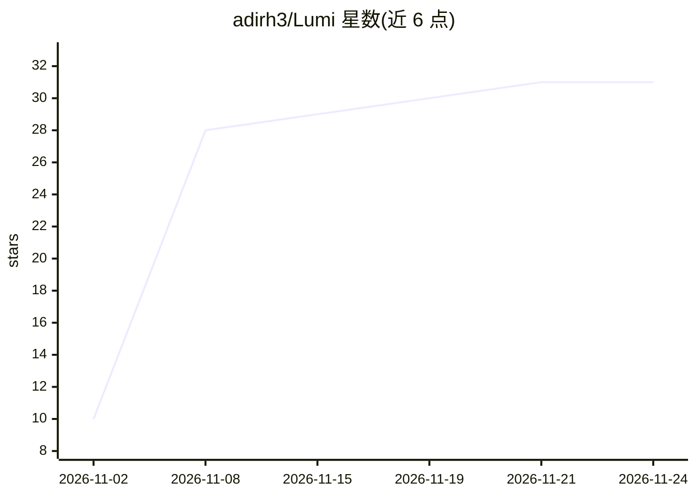

# adirh3/Lumi

⭐ 32 · C# · MIT · 推送 2026-11-23 · [GitHub](https://github.com/adirh3/Lumi) · [官网](https://letlumi.com) · 个人维护

**开源桌面 AI agent 应用，接入自有 AI 账号处理代码、文件与网络任务**

面向终端用户的原生桌面 AI agent 应用（Windows/macOS/Linux，C#/.NET + Avalonia），可执行代码修改、shell 命令、文件与网络任务，并支持 Android/移动网页伴侣端接续对话。模型接入方式包括 GitHub Copilot、ChatGPT 计划登录、API 提供商（OpenRouter、Microsoft Foundry 等）或本地模型（Ollama、LM Studio）；agent 运行时由 GitHub Copilot SDK 提供，即使使用其他模型提供商，Copilot 运行时仍执行 agent。支持 MCP 连接器、图像生成、技能与记忆、工具审批（含可选的 Copilot 本地 OS 沙箱）。桌面包自包含，无需 .NET SDK 安装。

## 筛选速览

| 维度 | 判定 | 备注 |
|---|---|---|
| AI 角色 | `ai-native` | 本体是模型或模型工具 |
| 许可风险 | `permissive` | MIT |
| 部署形态 | `desktop` | 安装包/桌面程序 |
| 模型依赖 | local-ok | 支持本地模型 |
| 硬件要求 | — | 无带数字的原话,不猜 |
| 安装摩擦 | `medium` | 含编译或系统依赖之一 |
| 成熟度 | — | 结构信号不足 |

## 能力要点

- 多接入路径：GitHub Copilot、ChatGPT 计划登录、API 提供商、本地模型（Ollama/LM Studio）
- Copilot SDK 提供 agent 运行时，流式回复、推理与工具活动可见
- Android APK 与移动网页/PWA 伴侣端接续桌面对话
- MCP 连接器、技能/自定义 agent/记忆、项目组织与工具审批控制

## 适用场景

- 在桌面上用对话方式完成代码修改、shell 命令与文件任务
- 用已有 Copilot 或 ChatGPT 订阅驱动本地 agent，不另付 API 费用
- 在手机上继续桌面端开始的对话任务

## 场景标签

`AI 助手` `编码 Agent` · 领域:编码与开发

## 证据(README 行号)

> L5: Work on code, files, documents and the web, and pick up a task from your phone.
> L6: Bring GitHub Copilot, a ChatGPT plan, an API key or a local model. Lumi is a
> L9: The GitHub Copilot SDK supplies the agent runtime.

## 星数曲线

2026-11-02 10 → 2026-11-24 31（+21）

---
*卡片 v1 · prompt 1.4 · 生成 2026-11-18 · 置信度 high · 依据 README sha `434747cbe1c3` · [字段定义](../../DATASET.md)*
