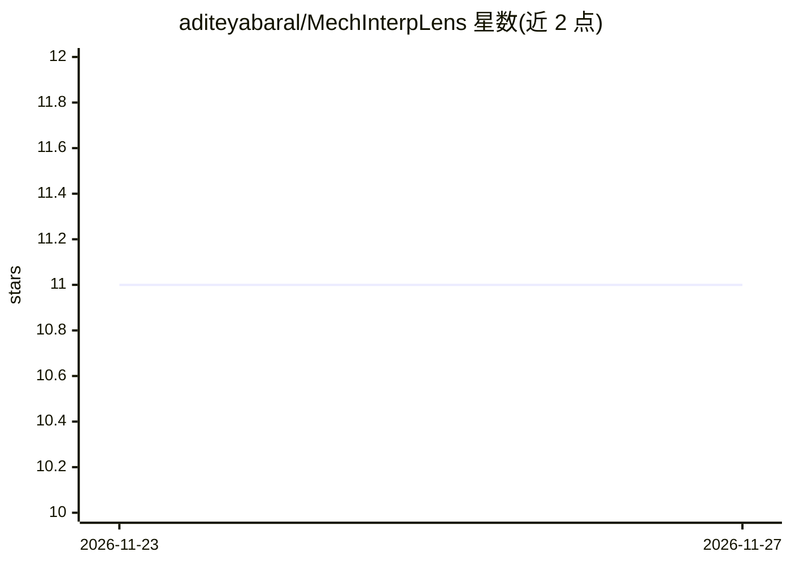

# aditeyabaral/MechInterpLens

⭐ 11 · Python · MIT · 推送 2026-11-22 · [GitHub](https://github.com/aditeyabaral/MechInterpLens) · 个人维护

**小模型机制可解释性研究的起步模板：训练玩具模型并定位关键神经元**

基于 TransformerLens 的项目模板，覆盖从训练到分析的完整流程：构建字符级 tokenizer、生成数据集、训练小型 GPT-2，随后捕获每个神经元与注意力头在各答案 token 上的激活，用稀疏探针（LASSO）初筛，再逐一消融组件并绘制准确率下降图以找出关键回路。通用部分已实现，任务相关部分以 TODO 标记待用户填写；提供 Colab 快速体验、文档入门与阅读清单，MIT 许可。

## 筛选速览

| 维度 | 判定 | 备注 |
|---|---|---|
| AI 角色 | `ai-native` | 本体是模型或模型工具 |
| 许可风险 | `permissive` | MIT |
| 部署形态 | `None` |  |
| 模型依赖 | — | README 未给出锁定关系 |
| 硬件要求 | — | 无带数字的原话,不猜 |
| 安装摩擦 | `low` | 无编译、无系统依赖或容器化 |
| 成熟度 | — | 结构信号不足 |

## 能力要点

- 七步工作流：tokenizer→数据集→训练→提示→捕获激活→探针初筛→消融定位
- 稀疏探针（LASSO）从 512 个神经元中初筛承载信息者
- 待改动处均以 TODO 标记并附工作示例注释
- 提供零消融与均值消融等概念的入门文档及阅读清单

## 适用场景

- 在自己设计的任务上训练玩具模型并分析其内部回路
- 机制可解释性入门学习与教学演示
- 为可解释性研究项目复用激活捕获与消融实验流程

## 场景标签

`教程课程` · 领域:学习与行业

## 证据(README 行号)

> L3: MechInterpLens is a starting point for **mechanistic interpretability** ("mechinterp") projects on small transformer
> L17: Train a tiny transformer on a task you design, then find the neurons and attention heads that drive it.
> L20: - **Look inside it:** the activations of every neuron and head at each answer token, and sparse probes

## 星数曲线

2026-11-23 11 → 2026-11-27 11（+0）

---
*卡片 v1 · prompt 1.4 · 生成 2026-11-23 · 置信度 high · 依据 README sha `c5ea52d60cf6` · [字段定义](../../DATASET.md)*
