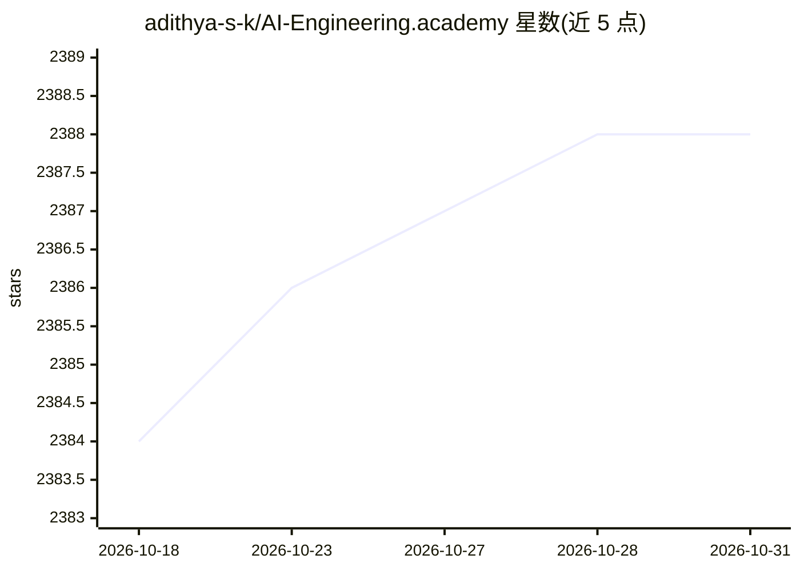

# adithya-s-k/AI-Engineering.academy

⭐ 2,388 · Jupyter Notebook · MIT · 推送 2026-02-27 · [GitHub](https://github.com/adithya-s-k/AI-Engineering.academy) · [官网](https://aiengineering.academy) · 组织维护

**面向 AI 工程的学习路径课程库：从提示工程到 AI Agent**

由 CognitiveLab 发起的 AI 工程学习课程仓库，将应用 AI 知识组织为结构化学习路径，覆盖提示工程、RAG、微调、部署（标注 Coming Soon）、AI Agents 与实战项目六大方向；每条路径包含概念讲解、动手实践与真实场景项目。给希望系统学习生产级 AI 技能的学习者使用。通过选择路径、按序完成模块、做练习和项目的方式学习，社区可通过 Fork/PR 贡献内容。MIT 许可。

## 筛选速览

| 维度 | 判定 | 备注 |
|---|---|---|
| AI 角色 | `ai-knowledge` | 知识聚合/清单类 |
| 许可风险 | `permissive` | MIT |
| 部署形态 | `None` |  |
| 模型依赖 | — | README 未给出锁定关系 |
| 硬件要求 | — | 无带数字的原话,不猜 |
| 安装摩擦 | `low` | 无编译、无系统依赖或容器化 |
| 成熟度 | — | 结构信号不足 |

## 能力要点

- 六大学习路径：提示工程、RAG、微调、部署、AI Agents、项目
- 每条路径配套练习与端到端实战项目
- 社区驱动贡献（Fork/PR 流程）

## 适用场景

- 系统学习从提示工程到微调的 LLM 应用技能
- 按路径动手构建 RAG 系统与 AI Agent 项目
- 加入社区共同完善课程内容

## 场景标签

`教程课程` · 领域:学习与行业

## 证据(README 行号)

> L27: ## 🗺️ Learning Paths
> L29: ### 1. Prompt Engineering

## 星数曲线

2026-10-18 2,384 → 2026-10-31 2,388（+4）

---
*卡片 v1 · prompt 1.4 · 生成 2026-10-22 · 置信度 high · 依据 README sha `a9883143e193` · [字段定义](../../DATASET.md)*
