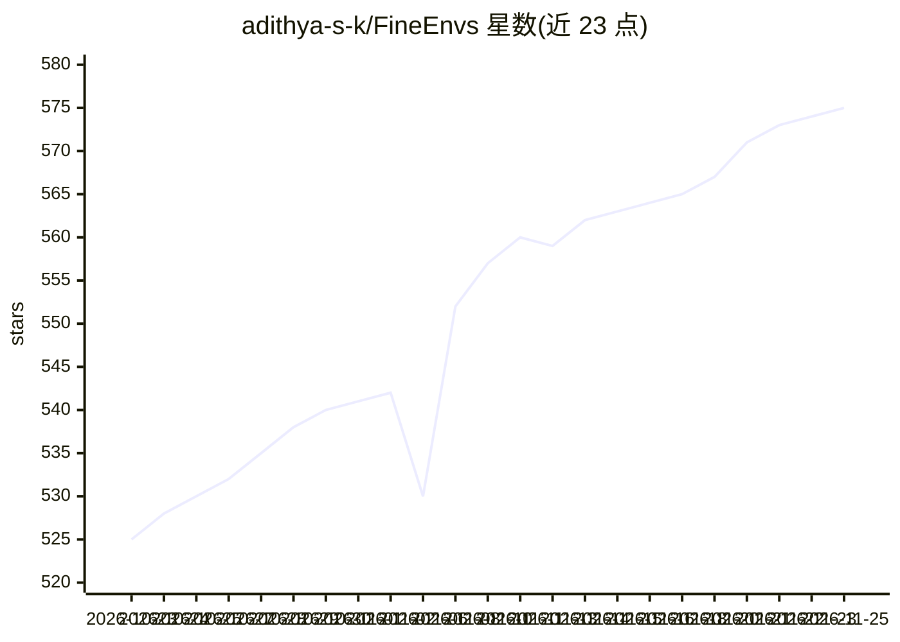

# adithya-s-k/FineEnvs

⭐ 575 · Python · Apache-2.0 · 推送 2026-11-14 · [GitHub](https://github.com/adithya-s-k/FineEnvs) · [官网](https://huggingface.co/FineEnvs) · 个人维护

**面向 LLM 训练者的 RL 环境开源教程与项目集**

为 LLM 智能体构建强化学习环境的开源资源：包含《RL Environments 101》教程、7 个编号的端到端项目（LaTeX OCR、水彩绘制、GeoGuesser、数据分析任务集、多语言、仿真环境等），每个项目自带环境实现、notebook、可复现训练脚本与部署于 Hugging Face 的 Space。同一环境以 6 种框架方言实现便于对比；训练可经 HF Jobs 一条命令启动，无需自有 GPU。Apache 2.0 许可，索引由 project.yaml 自动生成。

## 筛选速览

| 维度 | 判定 | 备注 |
|---|---|---|
| AI 角色 | `ai-knowledge` | 知识聚合/清单类 |
| 许可风险 | `permissive` | Apache-2.0 |
| 部署形态 | `library` | 以包/库形式分发 |
| 模型依赖 | — | README 未给出锁定关系 |
| 硬件要求 | — | 无带数字的原话,不猜 |
| 安装摩擦 | `low` | 无编译、无系统依赖或容器化 |
| 成熟度 | — | 结构信号不足 |

## 能力要点

- 同一环境以 openenv/verifiers/skyrl_gym 等 6 种框架各实现一遍共 18 个实现
- 8 个环境部署为可访问的 Hugging Face Spaces
- 5,394 个验证过的数据分析 RL 任务及 4,677 条验证轨迹
- 训练用 HF Jobs 脚本可在无本地 GPU 条件下启动

## 适用场景

- 学习如何设计、构建并部署一个 RL 环境
- 对比不同 RL 框架在同一环境上的实现差异
- 直接复跑项目中的 GRPO 训练流水线

## 场景标签

`教程课程` `强化学习` · 领域:学习与行业

## 证据(README 行号)

> L1: FineEnvs — open source RL environments for training LLM agents
> L10: The ultimate guide to RL environments
> L21: So we're building the resource we wanted. Open source, end to end, and reproducible: how to *design* an

## 星数曲线

2026-10-23 525 → 2026-11-25 575（+50）

---
*卡片 v1 · prompt 1.4 · 生成 2026-11-25 · 置信度 mid · 依据 README sha `276479a8629a` · [字段定义](../../DATASET.md)*
