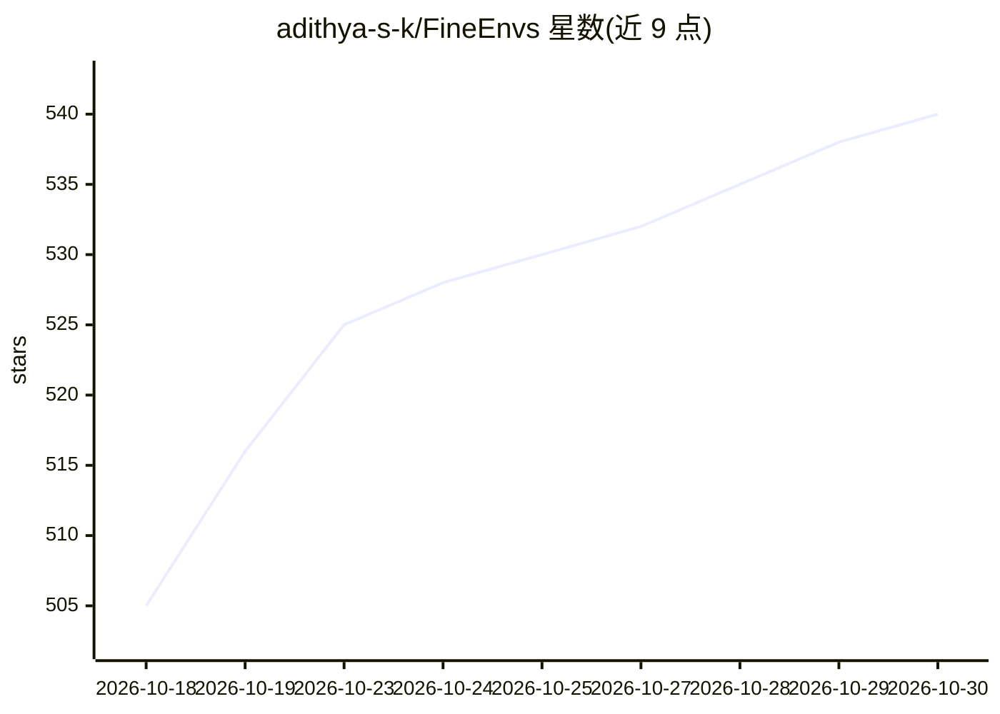

# adithya-s-k/FineEnvs

⭐ 540 · Python · Apache-2.0 · 推送 2026-10-28 · [GitHub](https://github.com/adithya-s-k/FineEnvs) · [官网](https://huggingface.co/FineEnvs) · 个人维护

**面向 LLM 智能体的开源 RL 环境项目集与教程资源**

以编号项目组织的端到端资源库：每个项目含 RL 环境、notebook、训练脚本与部署产物，覆盖环境设计、构建、部署、训练与评测全流程。项目示例包括 LaTeX OCR、GeoGuesser 视觉定位、5,394 个经验证的数据分析任务、多语言 OCR/ASR 环境与港口调度仿真环境，均附 GRPO/TRL 训练方案。另含 HF RL Explorer 等工具、长文与会议演讲。环境、数据集与模型发布在 Hugging Face，采用 Apache 2.0 许可，供做 LLM RL 训练与研究的人复现与扩展。

## 筛选速览

| 维度 | 判定 | 备注 |
|---|---|---|
| AI 角色 | `ai-knowledge` | 知识聚合/清单类 |
| 许可风险 | `permissive` | Apache-2.0 |
| 部署形态 | `library` | 以包/库形式分发 |
| 模型依赖 | — | README 未给出锁定关系 |
| 硬件要求 | — | 无带数字的原话,不猜 |
| 安装摩擦 | `low` | 无编译、无系统依赖或容器化 |
| 成熟度 | `idea` | |

## 能力要点

- 8 个自包含项目：环境 + notebook + 训练脚本 + Hub 产物
- Project 00 用 6 种框架各实现 3 个环境供对比学习
- 5,394 个经验证数据分析任务（奖励路径不含 LLM）
- 附 RL Explorer 工具、长文与演讲等教程内容

## 适用场景

- 学习如何设计、构建和部署 LLM RL 环境
- 用现成环境与任务集做 GRPO/RLHF 训练实验
- 对比不同 RL 框架（openenv/verifiers/skyrl_gym 等）的环境写法

## 场景标签

`强化学习` `教程课程` · 领域:学习与行业

## 证据(README 行号)

> L21: So we're building the resource we wanted. Open source, end to end, and reproducible: how to *design* an
> L25: Every environment here works. Every rollout has been executed. Every training curve came from a job you
> L188: Long-form writing and conference talks. Sources live in `content/`; each one ships to the

## 星数曲线

2026-10-18 505 → 2026-10-30 540（+35）

---
*卡片 v1 · prompt 1.4 · 生成 2026-10-22 · 置信度 mid · 依据 README sha `5735da29ec6a` · [字段定义](../../DATASET.md)*
