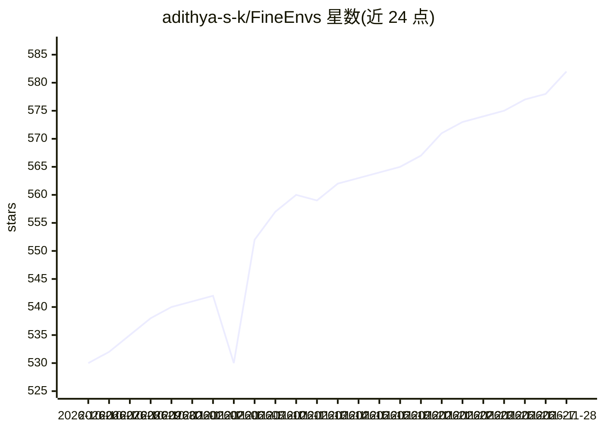

# adithya-s-k/FineEnvs

⭐ 582 · Python · Apache-2.0 · 推送 2026-11-24 · [GitHub](https://github.com/adithya-s-k/FineEnvs) · [官网](https://huggingface.co/FineEnvs) · 组织维护

**面向 LLM 从业者的开源 RL 环境教程与项目合集**

围绕 LLM 强化学习环境的开源合集，主张环境而非算法是当前瓶颈：以编号项目组织，每个项目自含环境代码、notebook、结果与 README。项目 00 是教程，用同一环境在 6 个框架各实现一遍（共 18 个实现、8 个已部署为 Spaces）；后续项目覆盖 LaTeX OCR、绘画偏好奖励、视觉地理定位、数据分析任务集、多语言 OCR/ASR、模拟环境与数学证明等，训练记录与模型发布在 Hugging Face Hub，部分项目处于 wip 状态。

## 筛选速览

| 维度 | 判定 | 备注 |
|---|---|---|
| AI 角色 | `ai-knowledge` | 知识聚合/清单类 |
| 许可风险 | `permissive` | Apache-2.0 |
| 部署形态 | `library` | 以包/库形式分发 |
| 模型依赖 | — | README 未给出锁定关系 |
| 硬件要求 | — | 无带数字的原话,不猜 |
| 安装摩擦 | `low` | 无编译、无系统依赖或容器化 |
| 成熟度 | — | 结构信号不足 |

## 能力要点

- 同一环境在 openenv/ors/nemo_gym/verifiers/skyrl_gym/gem 六框架并排实现（18 个实现、8 个已部署）
- 每个编号项目自含环境、notebook、结果与 README，索引由 project.yaml 自动生成
- SmolDataEnvs 提供 5,394 条经沙箱验证的数据分析任务与 4,677 条 SFT 轨迹
- 训练脚本支持 HF Jobs 与 Slurm，可在单命令启动的 GPU 上复现

## 适用场景

- 对比不同 RL 环境框架在实现同一环境时的写法差异
- 按教程训练 VLM 读取数学图像生成 LaTeX 并复现训练曲线
- 获取经沙箱验证的数据分析 RL 任务集用于训练与评测
- 为模拟类场景（港口调度、航空运营）查找带评测卡的环境

## 场景标签

`强化学习` `教程课程` · 领域:学习与行业

## 证据(README 行号)

> L10: The ultimate guide to RL environments
> L21: So we're building the resource we wanted. Open source, end to end, and reproducible: how to *design* an
> L38: |**00**|**RL Environments 101**|Three environments, six frameworks, side by side.|3|6|8|✅ stable|

## 星数曲线

2026-10-26 530 → 2026-11-28 582（+52）

---
*卡片 v1 · prompt 1.4 · 生成 2026-11-26 · 置信度 mid · 依据 README sha `b2d5260fb437` · [字段定义](../../DATASET.md)*
