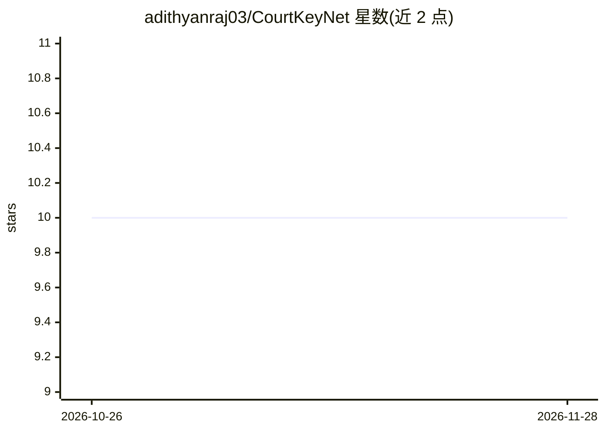

# adithyanraj03/CourtKeyNet

⭐ 10 · Python · MIT · 推送 2026-09-12 · [GitHub](https://github.com/adithyanraj03/CourtKeyNet) · 个人维护

**羽毛球场地关键点检测的深度学习模型（PyTorch）**

开源深度学习架构，用于从图像中检测羽毛球场地关键点，输出四个角点及置信度信号（heatmap 峰值、熵、几何有效性检查）。包含 Octave Feature Extractor、Polar Transform Attention 与 Geometric Consistency Loss 三个组件。提供预训练权重（Base/Fast 两档，经 HuggingFace 分发）、从零训练与微调脚本、conda 环境安装方式、训练配置文件及一个 GUI 推理工具。预训练权重覆盖羽毛球与网球场图像；从零训练声明需 14 万张以上图像。

## 筛选速览

| 维度 | 判定 | 备注 |
|---|---|---|
| AI 角色 | `ai-native` | 本体是模型或模型工具 |
| 许可风险 | `permissive` | MIT |
| 部署形态 | `library` | 以包/库形式分发 |
| 模型依赖 | — | README 未给出锁定关系 |
| 硬件要求 | — | 无带数字的原话,不猜 |
| 安装摩擦 | `low` | 无编译、无系统依赖或容器化 |
| 成熟度 | — | 结构信号不足 |

## 能力要点

- 输出四角点热图/细化关键点，并附三类置信度指标
- 提供预训练权重 Base/Fast 两档，经 HuggingFace 分发
- 支持从零训练、微调与断点续训，附 YAML 配置
- 附带 GUI 推理工具选择权重与媒体文件

## 适用场景

- 体育视频分析中定位场地角点
- 生成比赛统计数据的前置场地检测
- 在自有场地图像数据集上微调模型

## 场景标签

`目标检测` · 领域:感知与多模态

## 证据(README 行号)

> L13: Excited to introduce **CourtKeyNet**, an open-sourced deep learning architecture stemming from sports video analysi
> L224: Paper Link: **CourtKeyNet: A novel octave-based architecture for precision badminton court detection with geometri

## 星数曲线

2026-10-26 10 → 2026-11-28 10（+0）

---
*卡片 v1 · prompt 1.4 · 生成 2026-11-20 · 置信度 mid · 依据 README sha `435cb22ae6ff` · [字段定义](../../DATASET.md)*
