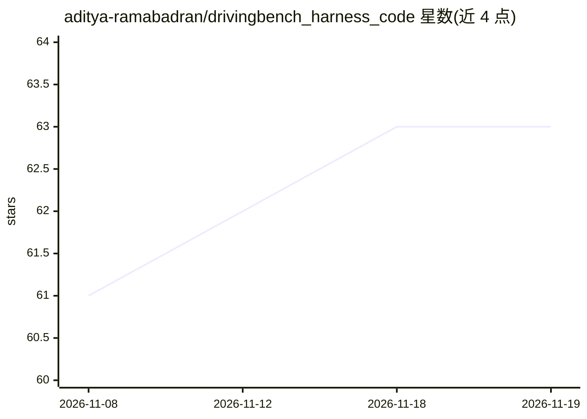

# aditya-ramabadran/drivingbench_harness_code

⭐ 63 · Python · MIT · 推送 2026-11-11 · [GitHub](https://github.com/aditya-ramabadran/drivingbench_harness_code) · [官网](https://drivingbench.com) · 个人维护

**让 AI 模型在封闭场地驾驶真车的基准测试套件**

DrivingBench Harness 是研究软件：让聊天模型（经 MCP 接入 Codex/Claude Code/Cursor）、决策模型或经训练的驾驶策略，在有人类驾驶员脚踩刹车的封闭场地以低速驾驶真实车辆（comma 设备 + openpilot，支持 Toyota 与 Tesla Model 3）。提供 observe/set_motion/stop_now 三个工具、笔记本端 runner 循环、Gaussian splat 模拟器，以及完整轨迹记录与回放。含速度上限、命令过期、踏板取消等软件限制，并声明这些不是安全功能，要求人类全程监督。

## 筛选速览

| 维度 | 判定 | 备注 |
|---|---|---|
| AI 角色 | `ai-ecosystem` | LLM/agent 周边工具 |
| 许可风险 | `permissive` | MIT |
| 部署形态 | `None` |  |
| 模型依赖 | locked-api |  |
| 硬件要求 | — | 无带数字的原话,不猜 |
| 安装摩擦 | `low` | 无编译、无系统依赖或容器化 |
| 成熟度 | `idea` | |

## 能力要点

- MCP 三工具（observe/set_motion/stop_now）+ runner 循环驱动 API 模型与训练策略
- v1.1 支持 Tesla Model 3 (HW3) 与 Toyota，附 Gaussian splat 模拟器
- 全程记录工具调用、遥测与图像为可回放轨迹
- 软件限制包括 3 m/s 默认速度上限、6 m/s 紧急切断、命令过期与踏板取消

## 适用场景

- 在封闭场地评测不同 AI 模型的真实车辆驾驶能力
- 无真车时用模拟器跑同一基准课程
- 录制并回放模型每次观察与决策做对比分析

## 场景标签

`模型评测` · 领域:评测与运维

## 证据(README 行号)

> L6: Any chat app that speaks MCP (Codex, Claude Code, Cursor) gets one server,
> L55: - **The runner loop** (docs/runner.md): a chat model on OpenRouter or
> L59: - **The simulator** (docs/sim.md): the v1.1 course as a Gaussian splat, driven

## 星数曲线

2026-11-08 61 → 2026-11-19 63（+2）

---
*卡片 v1 · prompt 1.4 · 生成 2026-11-18 · 置信度 high · 依据 README sha `a50a36a61480` · [字段定义](../../DATASET.md)*
