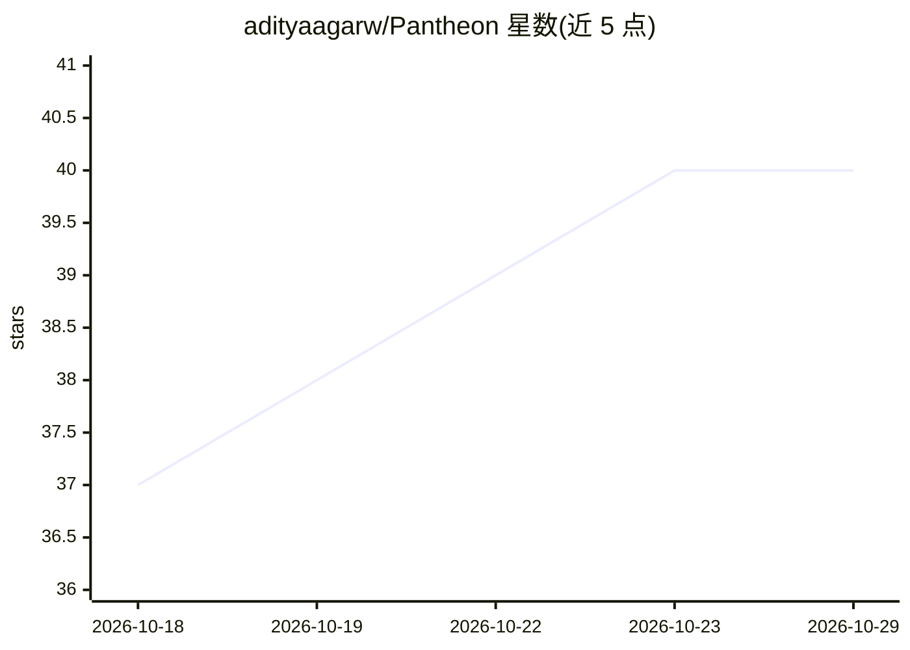

# adityaagarw/Pantheon

⭐ 40 · JavaScript · Apache-2.0 · 推送 2026-10-22 · [GitHub](https://github.com/adityaagarw/Pantheon) · [官网](https://pantheonstudio.si) · 个人维护

**桌面端 AI 团队工作台：用自然语言派活给多 agent 协作完成**

面向桌面用户的多 agent 编排应用：以一段需求描述，由内置设计师 Zeus 组建 agent 组织（角色、提示词、工具、汇报线），lead 规划分派、builder 执行、独立上下文的 checker 验收。可混编任意模型与 agent harness（Claude Code、Codex、Hermes、任意 ACP agent 或真人），在 3D 办公室中实时观察、中途干预、Timeline 回放。支持工具审批（auto/ask/deny）、token 预算与本地模型；数据存本地数据库。提供 Windows/macOS/Linux 安装包，自带环境无需 Docker/Python/Node。README 自述为早期软件，agent 可执行命令、改文件并消耗 key 额度。

## 筛选速览

| 维度 | 判定 | 备注 |
|---|---|---|
| AI 角色 | `ai-native` | 本体是模型或模型工具 |
| 许可风险 | `permissive` | Apache-2.0 |
| 部署形态 | `desktop` | 安装包/桌面程序 |
| 模型依赖 | local-ok | 支持本地模型 |
| 硬件要求 | — | 无带数字的原话,不猜 |
| 安装摩擦 | `low` | 无编译、无系统依赖或容器化 |
| 成熟度 | `idea` | |

## 能力要点

- Zeus 自动组建 agent 组织并配独立上下文的验收 checker
- 混编任意模型与 harness（Claude Code/Codex/Hermes/任意 ACP agent/真人）
- 3D 办公室实时观察 + Timeline 回放（1×–300×）+ 工具审批与 token 预算
- 单一安装包跨三平台，本地模型为第一等公民，数据存本地

## 适用场景

- 一句话发起产品发布、合同审查等多 agent 协作任务并得到验收结果
- 把不同厂商或本地的模型与 agent harness 组进同一团队分工干活
- 全程可视化监督 agent 的每条提示词、工具调用与花费并随时接管

## 场景标签

`多智能体` · 领域:Agent 开发

## 证据(README 行号)

> L5: **Describe the work. Pantheon staffs it with a team of AI agents, runs it in the open,
> L96: 1. **Add a model.** *Settings → Providers*: Anthropic, OpenAI, OpenRouter, Ollama, or any

## 星数曲线

2026-10-18 37 → 2026-10-29 40（+3）

---
*卡片 v1 · prompt 1.4 · 生成 2026-10-25 · 置信度 mid · 依据 README sha `afe0e96d75b0` · [字段定义](../../DATASET.md)*
