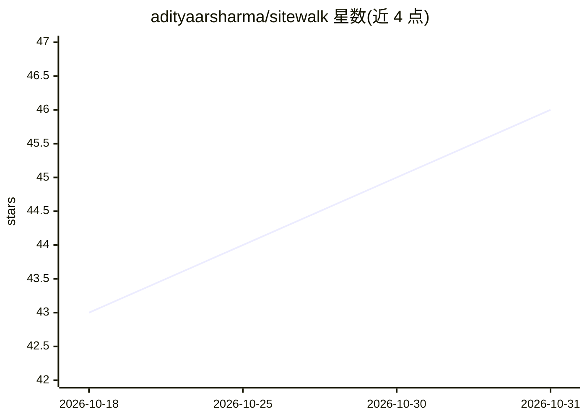

# adityaarsharma/sitewalk

⭐ 46 · Python · MIT · 推送 2026-10-26 · [GitHub](https://github.com/adityaarsharma/sitewalk) · [官网](https://audit.adityaarsharma.com/) · 个人维护

**给 SEO 从业者的 MCP 网站爬虫与技术 SEO 审计服务器**

Sitewalk 提供两种形态：托管版（在 ChatGPT 中以插件使用，免费额度每月 3 次审计、50-500 页）与开源自托管版（本仓库，含 LibreCrawl 引擎与 MCP 服务器，无页数上限，38 个 MCP 工具、30+ 项技术检查）。自托管通过一行安装脚本、Docker Compose 或 Python venv 运行，输出带品牌的 PDF 与 7 个 CSV；后台线程分块爬取、进度持久化到 SQLite WAL，AIMD 算法动态调节爬取延迟，检测 Cloudflare 等 WAF 挑战页，下载报告后服务器清除全部审计数据。另含 Claude Code 插件形式的 SEO growth agent，可生成修复计划并复查。

## 筛选速览

| 维度 | 判定 | 备注 |
|---|---|---|
| AI 角色 | `ai-ecosystem` | LLM/agent 周边工具 |
| 许可风险 | `permissive` | MIT |
| 部署形态 | `self-host` | docker 或自建部署 |
| 模型依赖 | locked-api |  |
| 硬件要求 | — | 无带数字的原话,不猜 |
| 安装摩擦 | `low` | 无编译、无系统依赖或容器化 |
| 成熟度 | `idea` | |

## 能力要点

- 38 个 MCP 工具供 AI 助手直接调用，30+ 项技术 SEO 检查
- 后台线程分块爬取 + SQLite WAL 持久化，返回 session_id 供轮询
- 指纹识别 Cloudflare/Akamai/DataDome/Imperva/PerimeterX 挑战页
- AIMD 控制器动态调节爬取延迟，下载后服务器端数据清零

## 适用场景

- 让 AI 助手对网站做全站技术 SEO 审计并拿到 PDF/CSV 报告
- 代理机构为客户批量审计且不在服务器留存数据
- 在 Claude Code/Cursor/Codex 中通过 MCP 调用爬虫与审计工具

## 场景标签

`网页抓取` · 领域:效率与自动化

## 证据(README 行号)

> L89: > **Model Context Protocol (MCP)** is the open standard that lets AI assistants like Claude, Cursor, or Codex call 
> L133: 38 MCP tools your agent calls directly. No GUI app to babysit, no SaaS dashboard to log into, no CSV exports to up

## 星数曲线

2026-10-18 43 → 2026-10-31 46（+3）

---
*卡片 v1 · prompt 1.4 · 生成 2026-10-25 · 置信度 mid · 依据 README sha `a23bf8de72d3` · [字段定义](../../DATASET.md)*
