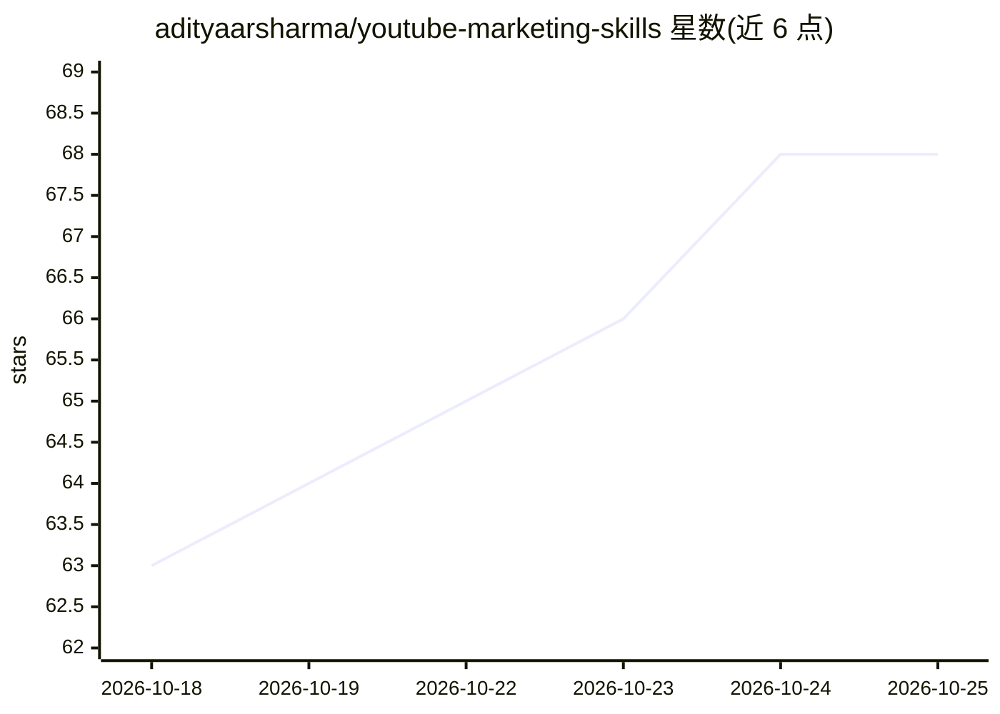

# adityaarsharma/youtube-marketing-skills

⭐ 68 · JavaScript · MIT · 推送 2026-10-10 · [GitHub](https://github.com/adityaarsharma/youtube-marketing-skills) · [官网](https://adityaarsharma.com) · 个人维护

**连接 AI agent 与真实 YouTube 频道的技能套件 + MCP 服务器**

面向开发者、顾问与产品制造者的 YouTube 增长工具包：21 个斜杠命令覆盖选题、脚本、SEO、Shorts、缩略图与分析，另含 10 个通过 OAuth2 读写真实频道数据的 MCP 工具（读取私有分析、回写标题/描述/标签、发布 WordPress 伴随文章）。以 git clone + npm install 方式本地运行，需 Node.js 18+ 与启用 YouTube Data/Analytics API 的 Google Cloud 项目及 OAuth 桌面凭证；兼容 Claude Code、Claude Desktop、Cursor、Windsurf、Codex、Gemini CLI 及任意 MCP 客户端。视频生产类集成（Remotion/FFmpeg/ElevenLabs 等）多标注为 roadmap。

## 筛选速览

| 维度 | 判定 | 备注 |
|---|---|---|
| AI 角色 | `ai-ecosystem` | LLM/agent 周边工具 |
| 许可风险 | `permissive` | MIT |
| 部署形态 | `library` | 以包/库形式分发 |
| 模型依赖 | — | README 未给出锁定关系 |
| 硬件要求 | — | 无带数字的原话,不猜 |
| 安装摩擦 | `medium` | 含编译或系统依赖之一 |
| 成熟度 | — | 结构信号不足 |

## 能力要点

- 21 个命令覆盖策略、脚本、SEO、分析与多平台改编
- OAuth2 直读私有分析数据并回写 SEO 到 YouTube
- 10 个 MCP 工具本地运行，数据不离开本机
- 6 种频道模板与 DataForSEO/WordPress MCP 集成

## 适用场景

- 在我的 agent 里直接生成基于真实关键词数据的视频 SEO
- 批量刷新低表现视频的标题描述标签
- 发布带 VideoObject schema 的 WordPress 伴随文章以双端排名
- 基于私有分析数据做频道健康审计与选题缺口分析

## 场景标签

`AI 写作` · 领域:内容生成

## 证据(README 行号)

> L20: An **agent-agnostic** skill suite + MCP server that connects your AI agent of choice to your **real YouTube channel
> L67: Open your agent (Claude Code, Cursor, Codex, Windsurf, Gemini CLI — any MCP+Skills client) and type `/youtube-strat

## 星数曲线

2026-10-18 63 → 2026-10-25 68（+5）

---
*卡片 v1 · prompt 1.4 · 生成 2026-10-24 · 置信度 high · 依据 README sha `d6611a044e79` · [字段定义](../../DATASET.md)*
