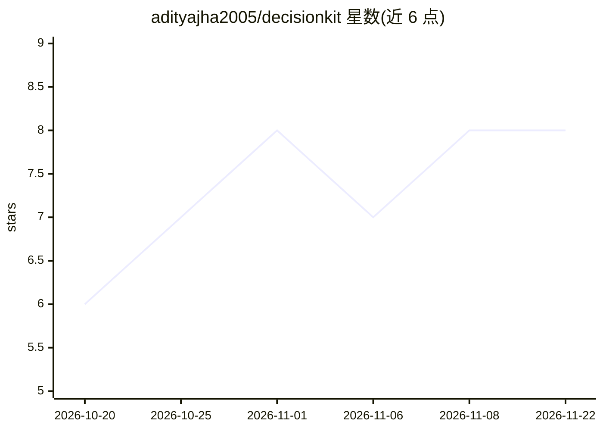

# adityajha2005/decisionkit

⭐ 8 · TypeScript · MIT · 推送 2026-10-10 · [GitHub](https://github.com/adityajha2005/decisionkit) · [官网](https://www.npmjs.com/package/@adxtya21/decisionkit) · 个人维护

**为编码 agent 与 CI 提供概率打分的决策 CLI/MCP 工具**

decisionkit 将文本的二元判断、多选、评分、排序问题封装为返回概率的决策 API 客户端，提供 CLI、Claude Code 插件和 MCP server 三种使用形式。请求发送至用户配置的单一 provider（OpenAI Decisions API、Jev、经 OpenRouter 的 Jev，或复用 Claude Code 登录的 claude），结果带各选项概率，支持阈值退出码供脚本与 CI 使用，并内置本地使用日志与密钥隔离机制。需 Node.js ≥ 20，无默认 provider。

## 筛选速览

| 维度 | 判定 | 备注 |
|---|---|---|
| AI 角色 | `ai-ecosystem` | LLM/agent 周边工具 |
| 许可风险 | `permissive` | MIT |
| 部署形态 | `library` | 以包/库形式分发 |
| 模型依赖 | locked-api |  |
| 硬件要求 | — | 无带数字的原话,不猜 |
| 安装摩擦 | `low` | 无编译、无系统依赖或容器化 |
| 成熟度 | — | 结构信号不足 |

## 能力要点

- binary/choice/score/rank 四类问题，返回逐选项概率
- CLI、Claude Code 插件、MCP server 三种运行形式
- 退出码遵循 grep 约定，适配脚本与 GitHub Actions CI
- 只读取 DECISIONKIT_* 环境变量，密钥存入 OS 安全存储

## 适用场景

- 让编码 agent 对 issue 做分类分诊，低置信度的转人工检查
- 在 CI 脚本中用退出码判断提交信息或 API 变更
- 把多个相关判断合并到一次调用以共享连接开销

## 场景标签

 · 领域:开发者工具/LLM 基础设施

## 证据(README 行号)

> L5: Fast, cheap, closed-form decisions for coding agents, scripts and CI. You ask a question about a piece of text: yes/
> L14: You can use it as a **CLI**, as a **Claude Code plugin**, or as an **MCP server** for Codex, Cursor, VS Code, Gemin

## 星数曲线

2026-10-20 6 → 2026-11-22 8（+2）

---
*卡片 v1 · prompt 1.4 · 生成 2026-11-20 · 置信度 high · 依据 README sha `ebabc4118cf6` · [字段定义](../../DATASET.md)*
