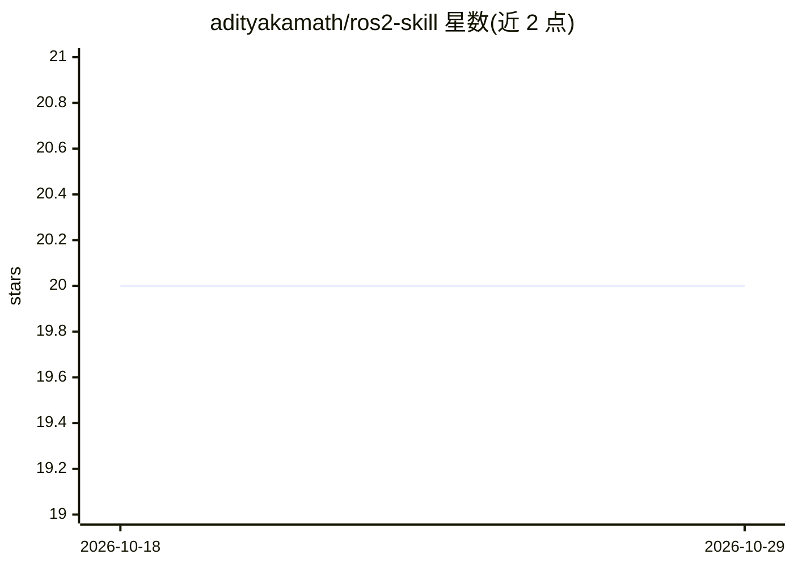

# adityakamath/ros2-skill

⭐ 20 · Python · Apache-2.0 · 推送 2026-07-16 · [GitHub](https://github.com/adityakamath/ros2-skill) · [官网](kamathrobotics.com) · 个人维护

**让 AI agent 通过自然语言控制 ROS 2 机器人的技能包**

Agent Skill 形式的 ROS 2 机器人控制工具：AI agent 读取 SKILL.md 理解可用命令，通过 ros2_cli.py 以 rclpy 直接与 ROS 2 交互，无需 rosbridge。提供 profile 优先解析与运行时内省两条路径、安全限制与预检、传感器图像捕获、诊断及 Discord 报告等能力。工具无关，可被 nanobot、Claude 等任意能加载 Agent Skills 的运行时使用，常部署在机器人本机。需 Python 3.9+、已 source 的 ROS 2 环境与 tmux；已在 ROS 2 Kilted 与树莓派上测试。

## 筛选速览

| 维度 | 判定 | 备注 |
|---|---|---|
| AI 角色 | `ai-ecosystem` | LLM/agent 周边工具 |
| 许可风险 | `permissive` | Apache-2.0 |
| 部署形态 | `None` |  |
| 模型依赖 | — | README 未给出锁定关系 |
| 硬件要求 | — | 无带数字的原话,不猜 |
| 安装摩擦 | `low` | 无编译、无系统依赖或容器化 |
| 成熟度 | — | 结构信号不足 |

## 能力要点

- agent 经 ros2_cli.py 以 rclpy 直接控制 ROS 2，无需 rosbridge
- Path A profile 优先 / Path B 运行时内省的命令解析双路径
- 安全限制、预检与 resolve→act→verify 执行循环
- 传感器图像捕获与 Discord 图像/报告集成

## 适用场景

- 通过对话让 AI agent 查询话题、控制机器人移动或触发急停
- 在机器人本机运行 agent 会话并远程经消息层接入
- 为 ROS 2 开发调试提供 agent 可调用的 CLI 工具集

## 场景标签

 · 领域:机器人/Agent 工具

## 证据(README 行号)

> L13: An AI agent skill that lets agents control ROS 2 robots through natural language. The agent reads `SKILL.md`, under
> L19: **ros2-skill** is tool-agnostic: any AI agent/runtime that can load and execute Agent Skills can use ros2-skill to 

## 星数曲线

2026-10-18 20 → 2026-10-29 20（+0）

---
*卡片 v1 · prompt 1.4 · 生成 2026-10-28 · 置信度 high · 依据 README sha `e3ea093b9bbd` · [字段定义](../../DATASET.md)*
