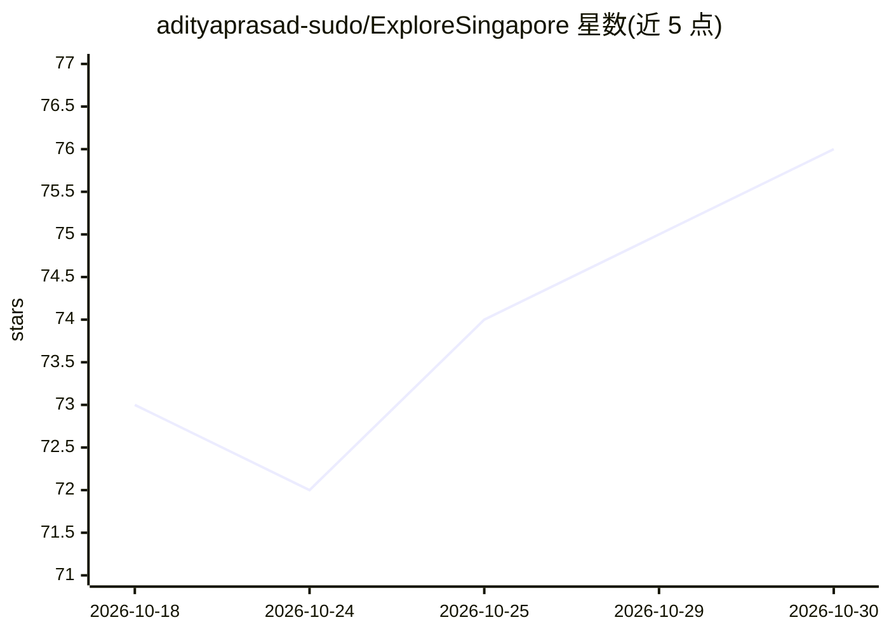

# adityaprasad-sudo/ExploreSingapore

⭐ 76 · Python · MIT · 推送 2026-04-21 · [GitHub](https://github.com/adityaprasad-sudo/ExploreSingapore) · [官网](https://exploresingapore.vercel.app/) · 个人维护

**新加坡法律/历史/基础设施的 RAG 知识问答引擎**

基于 Flask + LangChain + FAISS 的检索增强生成应用，语料来自 33,000+ 页新加坡法律与历史 PDF，用 BGE-M3 在本地生成 1024 维语义嵌入，FAISS 做向量检索。生成侧采用三级故障切换：主用 Gemini 2.0 Flash，备选经 OpenRouter 调 Llama 3.3 70B，三级经 Groq 调 Llama 3.3 70B。前端为 React + Framer Motion 定制组件，部署于 Hugging Face Spaces（Docker 托管）；README 给出依赖清单与 git clone 源码安装步骤。

## 筛选速览

| 维度 | 判定 | 备注 |
|---|---|---|
| AI 角色 | `ai-native` | 本体是模型或模型工具 |
| 许可风险 | `permissive` | MIT |
| 部署形态 | `None` |  |
| 模型依赖 | locked-api |  |
| 硬件要求 | — | 无带数字的原话,不猜 |
| 安装摩擦 | `low` | 无编译、无系统依赖或容器化 |
| 成熟度 | — | 结构信号不足 |

## 能力要点

- 33,000+ 页新加坡法律与历史文档语料
- Gemini / OpenRouter-Llama / Groq-Llama 三级 LLM 故障切换
- BGE-M3 本地嵌入 + FAISS 向量检索
- 部署于 Hugging Face Spaces（Docker 托管）

## 适用场景

- 查询新加坡法律、政策与历史事件的可靠信息
- 需要答案基于本地文档而非模型自由生成
- 低资源环境下运行 RAG 问答服务

## 场景标签

`RAG` `文档问答` · 领域:知识与检索

## 证据(README 行号)

> L12: The **Singapore Intelligence RAG System** is an intelligent platform that utilizes AI technology to deliver accurat
> L14: Unlike other LLMs, which have the tendency to "hallucinate" facts, the Singapore Intelligence RAG System employs **
> L20: 2. **Vectorization:** Used `BGE-M3` to create 1024-dimensional semantic embeddings.
> L21: 3. **Retrieval:** Implemented **FAISS (Facebook AI Similarity Search)** for millisecond-latency vector lookups.

## 星数曲线

2026-10-18 73 → 2026-10-30 76（+3）

---
*卡片 v1 · prompt 1.4 · 生成 2026-10-24 · 置信度 high · 依据 README sha `b80f9e7bb04d` · [字段定义](../../DATASET.md)*
