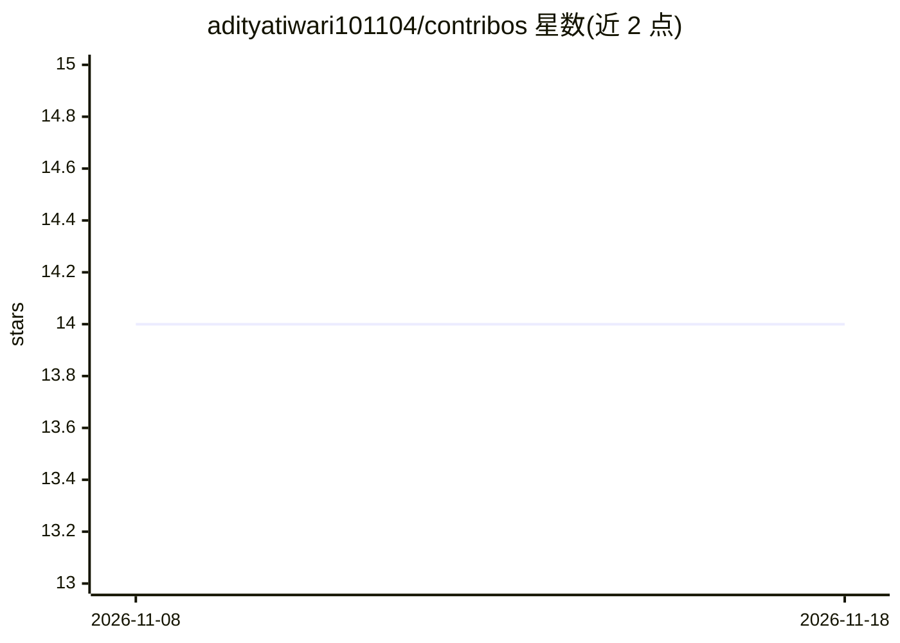

# adityatiwari101104/contribos

⭐ 14 · Python · MIT · 推送 2026-11-06 · [GitHub](https://github.com/adityatiwari101104/contribos) · [官网](https://contribos-iota.vercel.app) · 个人维护

**帮开源新人读规则、过评审、攒贡献记录的 CLI 与 MCP 服务器**

面向首次向开源项目提交贡献的开发者的命令行工具与 MCP 服务器：解析目标仓库的贡献文档、AI 政策、vouch 名单与 git 历史并给出带 file:line 引用的策略报告；按 find/policy/claim/tone/brief/check/review/record 等步骤协助选题、写提案、提交前自检、分类评审意见并生成可验证的贡献记录。核心功能仅需 git 离线运行，不代开 PR、不代写解释；AI 摘要为可选项，且只能引用已收集的证据。需 Python 3.10+，通过 PyPI 安装。

## 筛选速览

| 维度 | 判定 | 备注 |
|---|---|---|
| AI 角色 | `ai-enhanced` | 去掉 AI 部分产品仍成立 |
| 许可风险 | `permissive` | MIT |
| 部署形态 | `library` | 以包/库形式分发 |
| 模型依赖 | — | README 未给出锁定关系 |
| 硬件要求 | — | 无带数字的原话,不猜 |
| 安装摩擦 | `low` | 无编译、无系统依赖或容器化 |
| 成熟度 | — | 结构信号不足 |

## 能力要点

- 带 file:line 引用的仓库贡献政策/AI 政策雷达
- 提交前自检：AI 披露 trailer、测试验证（带/不带改动各跑一次）、scope 对比
- 9 个 MCP 工具供 Claude Code/Cursor/Codex 等调用，本地 stdio 服务器无额外依赖
- 生成可公开链接的贡献记录 HTML 页

## 适用场景

- 给陌生仓库提 PR 前先查清它的 AI 政策与贡献规范
- 为 issue 写投稿提案并核对自己的解释覆盖每个改动文件
- 把合并的 PR 沉淀为可验证的公开贡献档案

## 场景标签

 · 领域:开发者工具/开源协作

## 证据(README 行号)

> L11: **Get trusted. Get merged. Come back.** ContribOS helps new open-source contributors earn trust. It finds where you
> L76: Optional AI summaries: `CONTRIBOS_LLM=anthropic` (with `ANTHROPIC_API_KEY`) or `CONTRIBOS_LLM=openai` (with `OPENAI
> L94: - `mcp_server.py` is a dependency-free MCP stdio server.

## 星数曲线

2026-11-08 14 → 2026-11-18 14（+0）

---
*卡片 v1 · prompt 1.4 · 生成 2026-11-18 · 置信度 high · 依据 README sha `81067d1d5f1c` · [字段定义](../../DATASET.md)*
