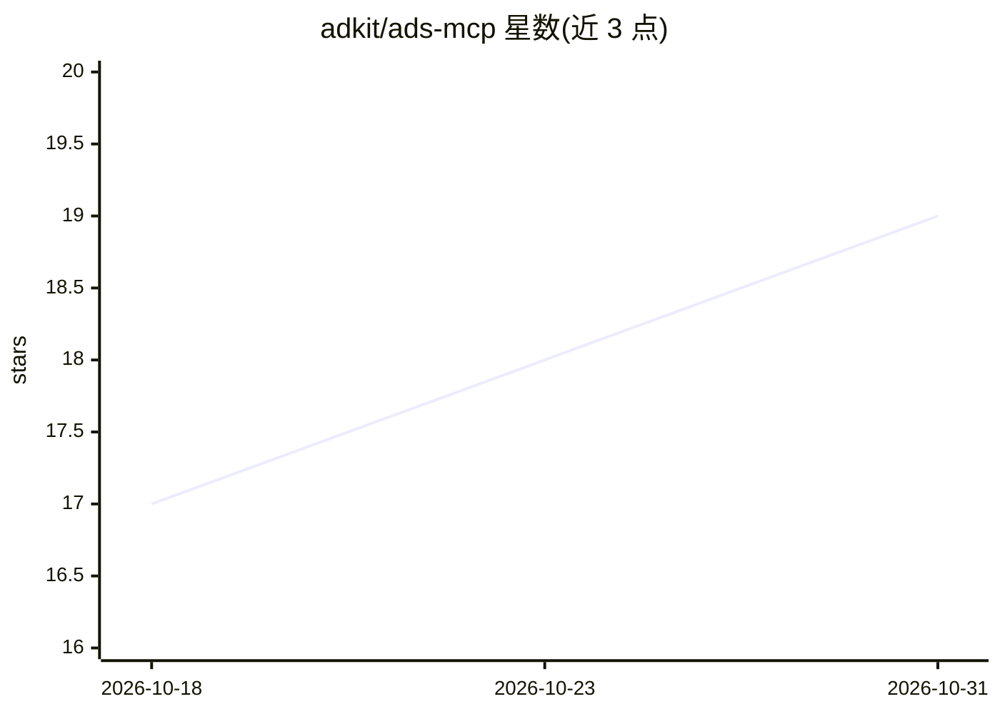

# adkit/ads-mcp

⭐ 19 · MIT · 推送 2026-10-23 · [GitHub](https://github.com/adkit/ads-mcp) · [官网](https://adkit.so) · 组织维护

**通过 MCP 让 AI agent 管理多平台广告活动的服务器**

Ads MCP 是一个 Model Context Protocol（MCP）服务器，托管于 mcp.adkit.so，供 Claude、Claude Code、ChatGPT、Cursor、Codex 等 MCP 客户端连接后管理 Google、Meta、TikTok、LinkedIn、Microsoft、Reddit 与 X Ads 七个平台的广告账户。功能包括创建广告活动、按日期/版位/人群拉取效果指标、检索 Meta/Google/LinkedIn 超 100 万条广告素材库、AI 生成广告图片与文案。采用草稿优先流程，所有变更需用户显式批准才发布，支持代理团队的多账户管理。提供 Claude Code 插件安装、MCP URL 接入、hermes 插件等安装方式。

## 筛选速览

| 维度 | 判定 | 备注 |
|---|---|---|
| AI 角色 | `ai-ecosystem` | LLM/agent 周边工具 |
| 许可风险 | `permissive` | MIT |
| 部署形态 | `None` |  |
| 模型依赖 | — | README 未给出锁定关系 |
| 硬件要求 | — | 无带数字的原话,不猜 |
| 安装摩擦 | `low` | 无编译、无系统依赖或容器化 |
| 成熟度 | — | 结构信号不足 |

## 能力要点

- 覆盖 Google/Meta/TikTok/LinkedIn/Microsoft/Reddit/X 七个广告平台
- 草稿优先流程：变更未经用户批准不发布
- 检索 Meta/Google/LinkedIn 广告素材库 100 万+ 条广告
- AI 生成广告图片与文案（adkit_studio）

## 适用场景

- 广告主在对话中让 AI agent 创建、分析和调整广告活动
- 代理团队在一个工作区管理多客户广告账户
- 检索竞争对手在 Meta/Google/LinkedIn 投放的广告素材

## 场景标签

`AI 写作` `图像生成` · 领域:内容生成

## 证据(README 行号)

> L9: **Ads MCP** is a Model Context Protocol (MCP) server for managing ad campaigns across **Google Ads, Meta Ads, TikTok
> L11: > **Draft-first:** every change starts as a draft — nothing goes live without your explicit approval. Multi-account
> L123: ## How it works

## 星数曲线

2026-10-18 17 → 2026-10-31 19（+2）

---
*卡片 v1 · prompt 1.4 · 生成 2026-10-29 · 置信度 high · 依据 README sha `753663fb449a` · [字段定义](../../DATASET.md)*
