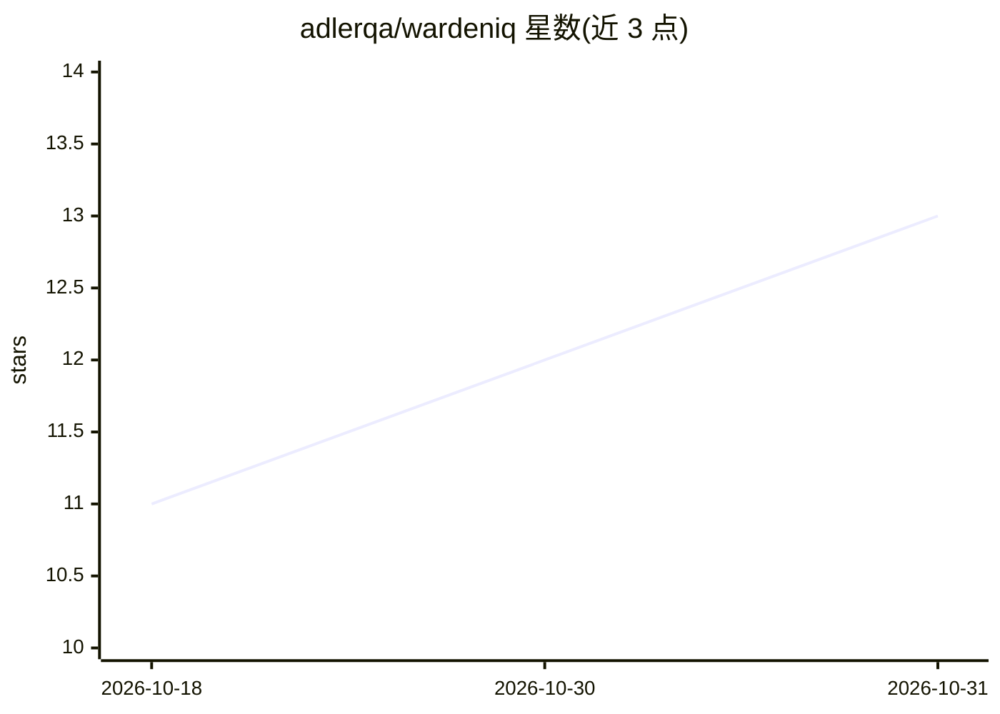

# adlerqa/wardeniq

⭐ 13 · Python · MIT · 推送 2026-10-30 · [GitHub](https://github.com/adlerqa/wardeniq) · [官网](https://adlerqa.in/products/wardeniq) · 组织维护

**把需求文档转成测试用例并持续核验代码覆盖的 QA 平台**

面向 QA 与开发团队的开源测试智能平台：上传 PRD/HLD/LLD 文档（PDF/DOCX/Markdown），生成 Functional/E2E/API/非功能四类测试用例，用例由可复用的原子步骤构成并自动去重；可监听仓库将 commit/PR 映射到受影响的用例并计算覆盖率；Mind Map 模式读取生产代码判定各 feature 覆盖状态；支持构建回归测试 Cycle、生成实现代码开 PR、输出 PDF 报告。模型自选：Ollama/OpenAI/Anthropic/Gemini/Mistral/Groq/Bedrock。以单容器应用部署，云端 MongoDB + 托管 LLM 为推荐路径，另提供捆绑 MongoDB 与本地模型的纯本地试用模式。自述为 Beta（v0.2.3），生成质量依赖本地模型与文档描述性。

## 筛选速览

| 维度 | 判定 | 备注 |
|---|---|---|
| AI 角色 | `ai-native` | 本体是模型或模型工具 |
| 许可风险 | `permissive` | MIT |
| 部署形态 | `desktop` | 安装包/桌面程序 |
| 模型依赖 | local-ok | 支持本地模型 |
| 硬件要求 | — | 无带数字的原话,不猜 |
| 安装摩擦 | `low` | 无编译、无系统依赖或容器化 |
| 成熟度 | `idea` | |

## 能力要点

- 从 PRD/HLD/LLD 文档生成四类结构化测试用例
- commit/PR 到测试用例的映射与覆盖率/自动化率统计
- Mind Map 读取生产代码判定 feature 覆盖状态
- 支持 Ollama/OpenAI/Anthropic/Gemini/Mistral/Groq/Bedrock 七种模型来源

## 适用场景

- 把产品需求文档快速转成可评审的测试用例库
- 跟踪每次 PR 对测试用例的影响与新增覆盖
- 为版本发布组建回归测试 Cycle 并逐条跟踪
- 审计代码相对需求文档的覆盖与缺口

## 场景标签

`RAG` `代码生成` · 领域:编码与开发

## 证据(README 行号)

> L8: > **QC for AI-built software.** Point wardenIQ at your requirement docs and your
> L16: Upload a PRD, wardenIQ generates a grounded test suite
> L44: - **Generate test cases from docs** — upload PRD/HLD/LLD files (PDF, DOCX, Markdown);

## 星数曲线

2026-10-18 11 → 2026-10-31 13（+2）

---
*卡片 v1 · prompt 1.4 · 生成 2026-10-31 · 置信度 high · 依据 README sha `895a49a1852a` · [字段定义](../../DATASET.md)*
