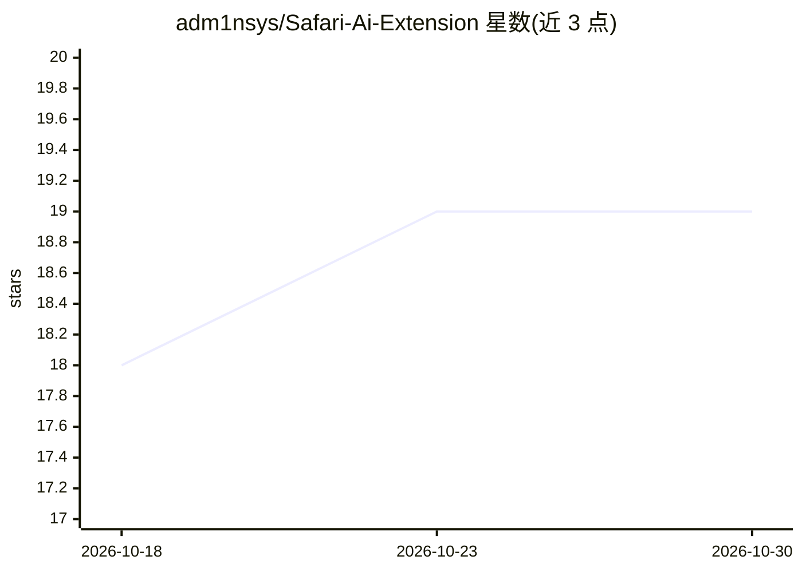

# adm1nsys/Safari-Ai-Extension

⭐ 19 · JavaScript · MIT · 推送 2026-07-02 · [GitHub](https://github.com/adm1nsys/Safari-Ai-Extension) · 个人维护

**AI 生成的 Safari 扩展示例与开发者指南（OS 27）**

由 Safari 27 的 Apple Intelligence "Describe an Extension" 功能从自然语言提示生成的 Web Extension 示例仓库，定位为开发者参考指南而非产品：文档说明端侧模型生成 manifest.json、content.js 与 popup 文件，并给出 AI 生成扩展的实际存储位置（MagicExtensions 目录）、通过反馈表单导出源码与原始提示词的方法、直接编辑文件与继续用 AI 助手迭代的两种途径，以及跨设备安装的未确认做法。示例扩展本身是 YouTube 界面微调（国家码、logo 配色、点赞统计、玻璃拟态头部）。全部内容基于 OS 27 开发者 beta，要求 macOS/iOS/iPadOS 27 及以上，路径与行为可能在正式版前变化。

## 筛选速览

| 维度 | 判定 | 备注 |
|---|---|---|
| AI 角色 | `ai-knowledge` | 知识聚合/清单类 |
| 许可风险 | `permissive` | MIT |
| 部署形态 | `None` |  |
| 模型依赖 | — | README 未给出锁定关系 |
| 硬件要求 | — | 无带数字的原话,不猜 |
| 安装摩擦 | `low` | 无编译、无系统依赖或容器化 |
| 成熟度 | `idea` | |

## 能力要点

- 定位为开发者参考指南：展示 AI 生成扩展的存储位置、源码提取与编辑方法
- 定位存储路径 ~/Library/.../Safari/MagicExtensions/，含原始生成提示词
- 提供免终端的源码导出途径：通过内置反馈表单组装完整源码快照
- 示例为 YouTube 界面微调扩展（国家码/logo 配色/点赞统计/玻璃拟态头部）

## 适用场景

- 在 OS 27 beta 上查找并编辑自己生成的 Safari AI 扩展源码
- 了解 Safari "Describe an Extension" 生成的扩展内部结构与存储机制
- 作为 AI 生成浏览器扩展的样例学习 manifest 与 content script 编写

## 场景标签

 · 领域:浏览器扩展/开发者工具

## 证据(README 行号)

> L3: A working example of a **Safari Web Extension generated by Apple Intelligence** — created entirely from a natural-la
> L5: This repo is meant less as a product and more as a **reference and guide for developers**: if you've thought *"I wan
> L13: Safari 27 can generate a complete Web Extension from a text prompt. You describe what you want, an on-device model 

## 星数曲线

2026-10-18 18 → 2026-10-30 19（+1）

---
*卡片 v1 · prompt 1.4 · 生成 2026-10-28 · 置信度 mid · 依据 README sha `e63cfb12654c` · [字段定义](../../DATASET.md)*
