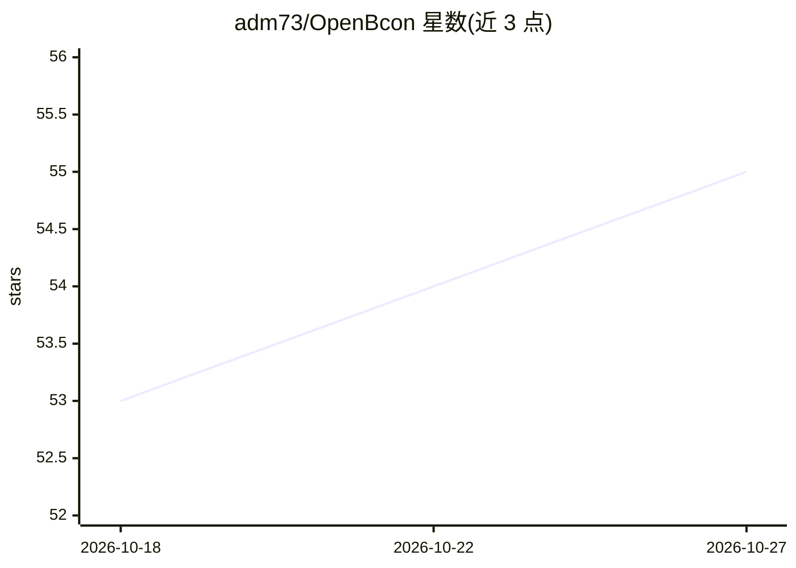

# adm73/OpenBcon

⭐ 55 · TypeScript · AGPL-3.0 · 推送 2026-09-06 · [GitHub](https://github.com/adm73/OpenBcon) · [官网](https://www.bconomics.ai) · 个人维护 · 中文 README

**面向融资顾问的开源 AI 融资工作台，管理项目与生成融资方案**

面向融资顾问、咨询顾问、孵化器与融资团队的自托管 Web 平台：覆盖发现融资项目（Grants & Loans 目录，支持中英文记录）、评估企业就绪度、管理公司与客户档案、生成可用于申请的商业计划与访谈指南（Interview Guide 七节文档）、组织申请/模板/报告等全流程。数据源支持 Google Sheets、Airtable 与 JSON 目录同步，通过 Admin Console 管理，采用 VPS + Docker Compose + PostgreSQL/MongoDB 部署，含 Caddy/Traefik 代理与管理员更新代理。社区版 AGPL-3.0，另提供商业许可（私有部署/白标等）。财务预测为简化正运营情景，README 提示需人工核验后再用于申请。

## 筛选速览

| 维度 | 判定 | 备注 |
|---|---|---|
| AI 角色 | `ai-native` | 本体是模型或模型工具 |
| 许可风险 | `dual` | AGPL-3.0 |
| 部署形态 | `self-host` | docker 或自建部署 |
| 模型依赖 | local-ok | 支持本地模型 |
| 硬件要求 | — | 无带数字的原话,不猜 |
| 安装摩擦 | `low` | 无编译、无系统依赖或容器化 |
| 成熟度 | — | 结构信号不足 |

## 能力要点

- 融资项目目录（Grants & Loans）+ 公司/客户记录 + 申请管理全流程工作台
- AI 生成融资就绪的商业计划与七节 Interview Guide 文档
- Google Sheets / Airtable / JSON 目录同步，分批导入并归档旧记录
- Admin Console 部署向导、更新代理与 Test/Live 双模式管理

## 适用场景

- 咨询顾问为客户一站式管理融资项目与申请材料
- 孵化器团队跟踪多家在孵企业的融资就绪度
- 自托管部署并按客户域名提供公开站点与工作区

## 场景标签

`AI 写作` · 领域:内容生成

## 证据(README 行号)

> L5: **The Open Source AI Platform for Funding & Business Consultants**
> L12: - generate funding-ready business plans

## 星数曲线

2026-10-18 53 → 2026-10-27 55（+2）

---
*卡片 v1 · prompt 1.4 · 生成 2026-10-24 · 置信度 low · 依据 README sha `fb1aff783b06` · [字段定义](../../DATASET.md)*
