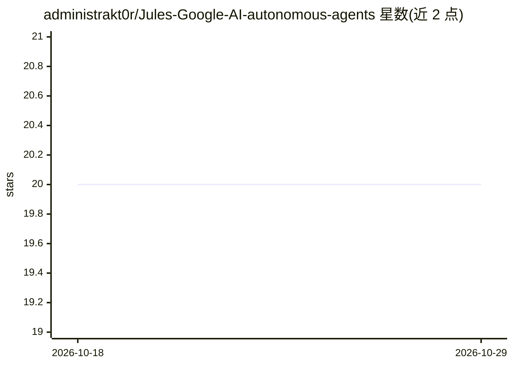

# administrakt0r/Jules-Google-AI-autonomous-agents

⭐ 20 · Shell · MIT · 推送 2026-10-28 · [GitHub](https://github.com/administrakt0r/Jules-Google-AI-autonomous-agents) · [官网](https://julesai.pages.dev/) · 个人维护

**面向任意代码库的可移植自主 AI agent 提示词集（26 个专家）**

提供一组可复制粘贴的专职 agent 提示词，用于在任意代码库上部署自主优化代理。每个提示词分为专家策略、仓库适配器与执行三段，要求 agent 先检查 Git 状态、探测实际语言/框架/工具链，将发现分类为 Detected/Not detected/Unknown 而非猜测，并遵循 ORIENT→DISCOVER→…→DOCUMENT 九阶段生命周期。覆盖安全、性能、缺陷、测试、UX、CI/CD、Docker、Kubernetes、Terraform 等 26 个专项。使用方式为将单个提示词复制到 agent 平台，附 validate_agents.sh 校验脚本与 CI 工作流。限制：提示词栈无关，需在目标仓库内使用。

## 筛选速览

| 维度 | 判定 | 备注 |
|---|---|---|
| AI 角色 | `ai-knowledge` | 知识聚合/清单类 |
| 许可风险 | `permissive` | MIT |
| 部署形态 | `None` |  |
| 模型依赖 | — | README 未给出锁定关系 |
| 硬件要求 | — | 无带数字的原话,不猜 |
| 安装摩擦 | `low` | 无编译、无系统依赖或容器化 |
| 成熟度 | — | 结构信号不足 |

## 能力要点

- 26 个专项 agent 提示词（安全、性能、缺陷、测试、CI/CD、K8s 等）
- Specialist Policy → Repository Adapter → Execution 三段式结构
- 九阶段标准生命周期（ORIENT→DISCOVER→…→DOCUMENT）由 JULES.md 约束
- 提供 validate_agents.sh 与 GitHub Actions 工作流校验提示词

## 适用场景

- 为我的代码库部署 24/7 自主优化、安全加固的 AI agent
- 在 agent 平台上按检测到的范围选择专项 agent 处理代码库
- 复用一套栈无关的 agent 策略模板适配不同技术栈仓库

## 场景标签

`提示工程` · 领域:Agent 开发

## 证据(README 行号)

> L3: Portable, specialized AI-agent prompts for arbitrary codebases. Each prompt separates **Specialist Policy → Reposito
> L48: Copy an individual prompt into an agent platform. It is intentionally stack-agnostic and should be used in the targ

## 星数曲线

2026-10-18 20 → 2026-10-29 20（+0）

---
*卡片 v1 · prompt 1.4 · 生成 2026-10-28 · 置信度 high · 依据 README sha `79b6dc1b1459` · [字段定义](../../DATASET.md)*
