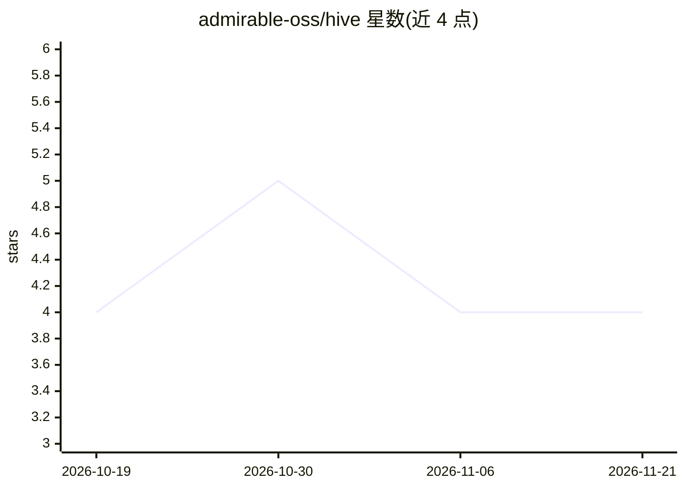

# admirable-oss/hive

⭐ — · [GitHub]() · 个人维护

**为编码 agent 提供持久运行环境的终端多路复用器与守护进程**

Go 编写的 agent 运行基础设施：以守护进程保持 agent 会话在终端关闭、SSH 断开、休眠甚至重启后继续运行；提供类 tmux 的多路复用界面（标签、分屏、Overview）、按 agent 隔离的 git worktree 工作区、状态检测（working/blocked/done/idle）、MCP server 与 Go SDK 供 agent 操作 agent，支持 SSH 远程机器、插件、Plans/Branches/Workflows 编排，覆盖 macOS/Linux/Windows，手机端提供只读观察应用。

## 筛选速览

| 维度 | 判定 | 备注 |
|---|---|---|
| AI 角色 | `ai-ecosystem` | LLM/agent 周边工具 |
| 许可风险 | `permissive` | — |
| 部署形态 | `library` | 以包/库形式分发 |
| 模型依赖 | — | README 未给出锁定关系 |
| 硬件要求 | — | 无带数字的原话,不猜 |
| 安装摩擦 | `low` | 无编译、无系统依赖或容器化 |
| 成熟度 | — | 结构信号不足 |

## 能力要点

- 守护进程让 agent 会话在断连、崩溃、重启后存活
- 类 tmux 多路复用界面与 agent 状态 Overview
- MCP server、Go SDK 与 skill 支持 agent 驱动 agent
- Plans/Branches/Workflows 提供多 agent 任务编排与冲突检测

## 适用场景

- 并行运行多个编码 agent 而互不干扰
- 长构建、大迁移、测试套件等超长任务后台托管
- 通过 SSH 在远程机器上运行和观察 agent
- 在 CI 中以 headless 模式执行 agent workflow

## 场景标签

`编码 Agent` `多智能体` · 领域:Agent 开发

## 证据(README 行号)

> L5:  The agent infrastructure for agents that don’t clock out
> L16: - **Bring your own agent.** Claude Code, Codex, OpenCode, Cursor, your own agent, whatever comes next. Hive doesn't
> L40: |Agents operating agents: `hive agent start/prompt/wait/read`, MCP server (`hive mcp`), Go SDK (`pkg/hiveapi`)|✅ wo

## 星数曲线

2026-10-19 4 → 2026-11-21 4（+0）

---
*卡片 v1 · prompt 1.4 · 生成 2026-11-21 · 置信度 high · 依据 README sha `30e7c6703309` · [字段定义](../../DATASET.md)*
