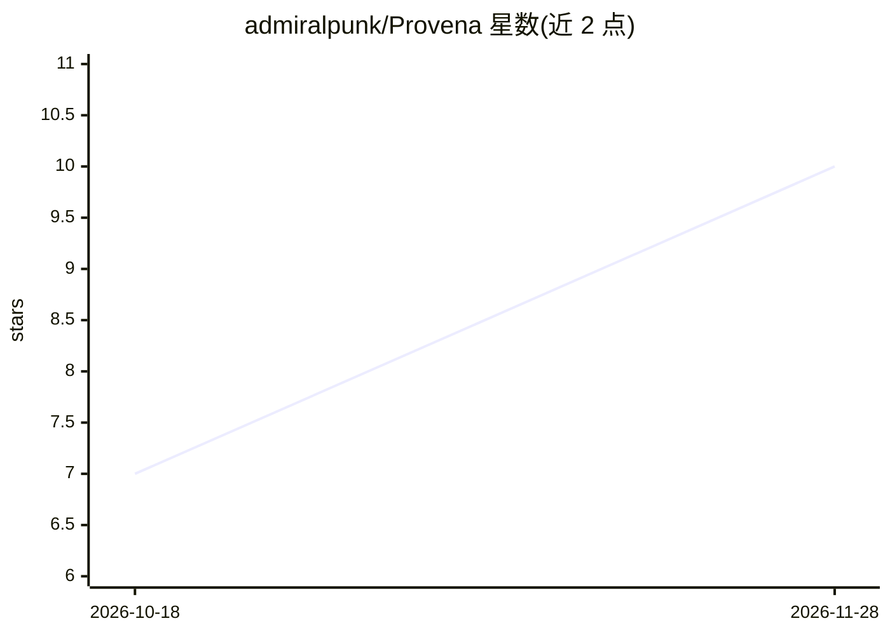

# admiralpunk/Provena

⭐ 10 · Python · MIT · 推送 2026-11-27 · [GitHub](https://github.com/admiralpunk/Provena) · [官网](https://admiralpunk.github.io/Provena/) · 个人维护

**为 AI 编码代理提供带溯源审计的自托管记忆（MCP）**

面向 Claude Code、Codex、Gemini CLI 等 MCP 客户端的自托管记忆服务：捕获对话轮次，抽取候选事实，检索相关上下文供后续会话使用。核心机制是保留证据链——每条记忆链接到原始事件、来源权威级别与人工审核状态，agent 键无法提升候选为事实；提供 memory_explain 追溯与人工审核控制台。基于 FastAPI + PostgreSQL/pgvector，抽取默认用本地 Ollama 模型，数据默认不出本机。检索按精确 scope，分支继承未实现。

## 筛选速览

| 维度 | 判定 | 备注 |
|---|---|---|
| AI 角色 | `ai-ecosystem` | LLM/agent 周边工具 |
| 许可风险 | `permissive` | MIT |
| 部署形态 | `self-host` | docker 或自建部署 |
| 模型依赖 | local-ok | 支持本地模型 |
| 硬件要求 | — | 无带数字的原话,不猜 |
| 安装摩擦 | `low` | 无编译、无系统依赖或容器化 |
| 成熟度 | — | 结构信号不足 |

## 能力要点

- append-only 事件存储，claim 始终回链原始证据
- 候选/已审两级权威：仅人工可提升事实，记忆不等于授权
- memory_explain 追溯声明到事件、抽取、审核与投递记录
- CI 上运行 127 项记忆投毒检查（标注植入事实而非拦截）

## 适用场景

- 让编码代理跨会话记住项目上下文并保留出处
- 防止错误或被植入的信息在后续会话中当作事实使用
- 审计代理记忆中每条事实的来源与审核历史

## 场景标签

`Agent 记忆` · 领域:Agent 开发

## 证据(README 行号)

> L12: Provena is open-source, self-hosted memory for AI coding agents. It plugs into **Claude Code, Codex, and Gemini CLI
> L63: Provena is one FastAPI service backed by PostgreSQL and pgvector. MCP and host hooks capture turns and retrieve att
> L144: **Which agents work?** Claude Code, Codex, and Gemini CLI have one-command setup with automatic capture. Other MCP

## 星数曲线

2026-10-18 7 → 2026-11-28 10（+3）

---
*卡片 v1 · prompt 1.4 · 生成 2026-11-28 · 置信度 high · 依据 README sha `0c6067141d3a` · [字段定义](../../DATASET.md)*
