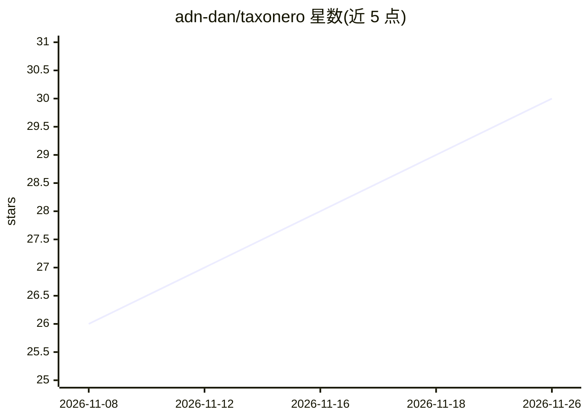

# adn-dan/taxonero

⭐ 30 · Python · AGPL-3.0 · 推送 2026-11-19 · [GitHub](https://github.com/adn-dan/taxonero) · 个人维护

**自托管照片物种识别工具：接入 Immich 等相册并写回标签**

面向摄影与自然观察爱好者的自托管 AI 物种识别服务：从 Immich、本地文件夹或照片应用（darktable、Lightroom Classic、Apple Photos 等）读取图片，检测主体、识别物种（鸟兽虫鱼植物真菌等），并用 GBIF 做地理合理性核查；高置信度案例自动确认，写入 Immich 层级标签与描述块。以独立 Docker 服务形式运行，仅通过 Immich 公共 API 交互，默认 DRY_RUN 不写任何内容，提供一键撤销已写入内容。附带审核看板（物种页、分布图、统计、CSV 导出）、连拍照片结果平滑、性别与生活阶段识别（可选）及公开识别页。图片本身从不被修改。

## 筛选速览

| 维度 | 判定 | 备注 |
|---|---|---|
| AI 角色 | `ai-native` | 本体是模型或模型工具 |
| 许可风险 | `viral` | AGPL-3.0 |
| 部署形态 | `desktop` | 安装包/桌面程序 |
| 模型依赖 | — | README 未给出锁定关系 |
| 硬件要求 | `gpu-8g` | |
| 安装摩擦 | `low` | 无编译、无系统依赖或容器化 |
| 成熟度 | — | 结构信号不足 |

## 能力要点

- 检测+物种识别+GBIF 地理核查三阶段流水线
- 仅通过 Immich 公共 API 的独立 Docker 服务，默认 DRY_RUN，写入可一键撤销
- 高置信度案例自动确认，连拍照片结果平滑去噪
- 可选的每物种小模型识别动物性别与生活阶段（准确率达标才启用）

## 适用场景

- 给 Immich 相册里的自然照片批量打上分类学层级标签
- 整理本地或 Lightroom 等相册中的鸟类、昆虫、植物照片并审核物种
- 在照片库上建立带分布图、季节性与 IUCN 状态的物种档案

## 场景标签

`目标检测` · 领域:感知与多模态

## 证据(README 行号)

> L7: Self-hosted AI species identification for your photos (birds, mammals, reptiles, amphibians, insects, spiders,
> L25: - Detects the subjects in each picture (boxes), identifies the species, and checks it against geography

## 星数曲线

2026-11-08 26 → 2026-11-26 30（+4）

---
*卡片 v1 · prompt 1.4 · 生成 2026-11-18 · 置信度 mid · 依据 README sha `4f5f46adee35` · [字段定义](../../DATASET.md)*
