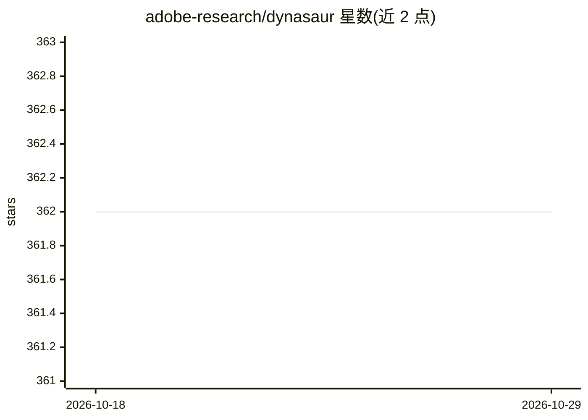

# adobe-research/dynasaur

⭐ 362 · Python · NOASSERTION · 推送 2026-08-05 · [GitHub](https://github.com/adobe-research/dynasaur) · 组织维护

**动态自我扩展动作库的 LLM agent 框架（COLM 2025）**

Adobe Research 发布的 LLM agent 框架（COLM 2025 论文）：以编程语言作为动作的统一表示，每步生成 Python 代码片段，可调用已有动作或在动作集不足时从零创建新动作、或组合既有动作，逐步形成可复用动作库。README 称其在 GAIA benchmark 上排名第一（截至撰写时，非集成方法）。安装需配置 .env 密钥（Azure API 等）、下载 GAIA 数据集（需 HuggingFace 写权限 token），并用 conda + pip requirements 搭建环境后运行 dynasaur.py。OpenAI API 支持列为 TODO。

## 筛选速览

| 维度 | 判定 | 备注 |
|---|---|---|
| AI 角色 | `ai-ecosystem` | LLM/agent 周边工具 |
| 许可风险 | `none` | NOASSERTION |
| 部署形态 | `library` | 以包/库形式分发 |
| 模型依赖 | — | README 未给出锁定关系 |
| 硬件要求 | — | 无带数字的原话,不猜 |
| 安装摩擦 | `low` | 无编译、无系统依赖或容器化 |
| 成熟度 | — | 结构信号不足 |

## 能力要点

- 每步生成 Python 代码片段作为动作的统一表示
- 动作不足时自动从零创建或组合已有动作，扩展可复用库
- 论文发表于 COLM 2025，附 arXiv 与 OpenReview 链接

## 适用场景

- 研究者在 GAIA 等 agent benchmark 上复现实验
- 探索动作库自我扩展的 LLM agent 机制

## 场景标签

`Agent 框架` · 领域:Agent 开发

## 证据(README 行号)

> L10: DynaSaur is a dynamic LLM-based agent framework published at COLM 2025 that uses a programming language as a univer
> L12: Empirically, DynaSaur exhibits remarkable versatility, recovering automatically when no relevant actions are availa

## 星数曲线

2026-10-18 362 → 2026-10-29 362（+0）

---
*卡片 v1 · prompt 1.4 · 生成 2026-10-21 · 置信度 mid · 依据 README sha `8e8da7ff2c3d` · [字段定义](../../DATASET.md)*
