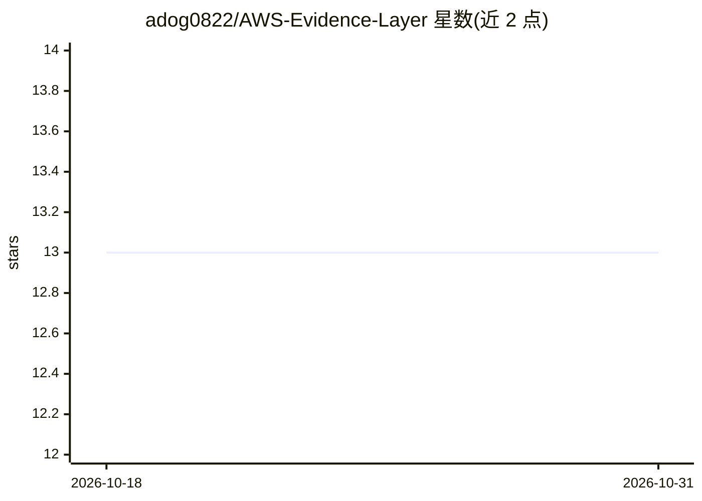

# adog0822/AWS-Evidence-Layer

⭐ 13 · TypeScript · MIT · 推送 2026-09-06 · [GitHub](https://github.com/adog0822/AWS-Evidence-Layer) · [官网](https://app.loxe.app/beta) · 组织维护

**面向 AWS 团队的 SOC 2 合规审计扫描器，输出可验证证据报告**

开源 SOC 2 合规扫描器（LoxeAI 免费层）：用户经 CloudFormation 部署只读 IAM Role，系统扫描 15 个 AWS 服务、6 个区域，映射到 12 项核心 SOC 2 控制，输出评分、差距图与 CSV 报告；每个发现带 SHA-256 哈希，审计方可独立复跑 API 调用验证。免费层评分为确定性规则，不调用模型；付费平台（$349，不在本仓库）包含 Claude 逐控制分析、Gideon 合规副驾驶、自定义控制构建器与 RBAC 工作区。运行于 Cloudflare Workers/D1/R2，付费版部署在 AWS ECS Fargate 并调用 Anthropic Claude API。

## 筛选速览

| 维度 | 判定 | 备注 |
|---|---|---|
| AI 角色 | `ai-enhanced` | 去掉 AI 部分产品仍成立 |
| 许可风险 | `permissive` | MIT |
| 部署形态 | `library` | 以包/库形式分发 |
| 模型依赖 | locked-api |  |
| 硬件要求 | — | 无带数字的原话,不猜 |
| 安装摩擦 | `low` | 无编译、无系统依赖或容器化 |
| 成熟度 | — | 结构信号不足 |

## 能力要点

- 只读 IAM Role 一次性部署，扫描 15 个 AWS 服务并映射 12 项 SOC 2 控制
- 每个发现附 SHA-256 哈希与原始 API 响应，可独立验证
- 免费层评分为确定性规则计算，不依赖模型
- 仓库内为开源扫描器与前端，付费平台（Gideon/RBAC/报告生成）另行托管

## 适用场景

- 初次做 SOC 2 认证的 AWS 原生小团队快速获得差距报告
- 向审计方提供可独立复核的证据链
- 以自然语言定义自定义合规检查（付费层）

## 场景标签

`网络安全` · 领域:学习与行业

## 证据(README 行号)

> L4: Read-only scan across 12 AICPA Trust Services Criteria, heuristic scoring in
> L11: 1. You deploy a read-only IAM role via CloudFormation (one click, ~2 min)
> L161: and regions. Free-tier scoring is fully deterministic, same evidence always
> L162: produces the same scores, no model involved. Paid analysis runs each control

## 星数曲线

2026-10-18 13 → 2026-10-31 13（+0）

---
*卡片 v1 · prompt 1.4 · 生成 2026-10-31 · 置信度 high · 依据 README sha `e44fa55576f5` · [字段定义](../../DATASET.md)*
