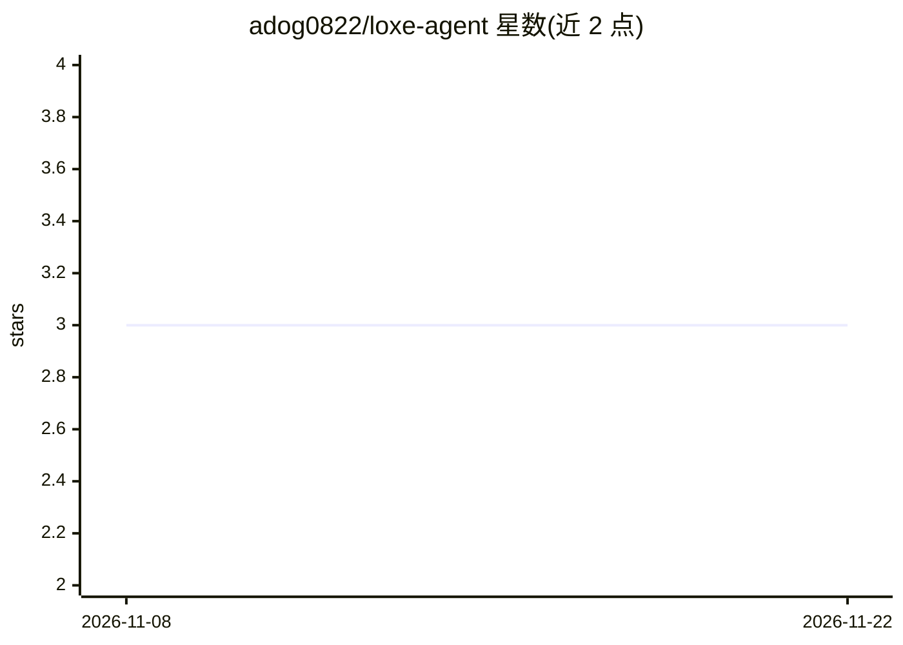

# adog0822/loxe-agent

⭐ 3 · JavaScript · MIT · 推送 2026-11-14 · [GitHub](https://github.com/adog0822/loxe-agent) · [官网](https://loxeagent.loxeai.com) · 个人维护

**AI Agent 安全测试工具：40 探针给出 A-F 评级与可验证证据账本**

针对 AI agent 的安全测试与评级工具：用 40 个确定性探针（判定由纯代码执行，不依赖模型）覆盖数据泄露、工具权限、注入抵抗、有害行为拒绝与运行卫生五类攻击，每次运行生成 SHA-256 哈希链与 Ed25519 签名的证据账本，任何第三方可离线重算校验。每个发现映射 SOC 2、OWASP LLM Top 10、NIST AI RMF 与 ISO 42001 控制项。可通过 Web 应用、GitHub Actions、CLI、Slack 等多种界面使用。评级仅表示在该日期对这 40 个探针的抵抗情况，不声明合规或安全认证。

## 筛选速览

| 维度 | 判定 | 备注 |
|---|---|---|
| AI 角色 | `ai-ecosystem` | LLM/agent 周边工具 |
| 许可风险 | `permissive` | MIT |
| 部署形态 | `library` | 以包/库形式分发 |
| 模型依赖 | — | README 未给出锁定关系 |
| 硬件要求 | — | 无带数字的原话,不猜 |
| 安装摩擦 | `low` | 无编译、无系统依赖或容器化 |
| 成熟度 | — | 结构信号不足 |

## 能力要点

- 40 个确定性探针，判定由纯代码执行，结果可复现
- 哈希链证据账本 + Ed25519 签名，支持浏览器与离线重算校验
- 发现项映射 SOC 2、OWASP LLM Top 10、NIST AI RMF、ISO 42001 控制项
- 提供 GitHub Actions 复合动作，可在 CI 中按最低评级阻断 PR

## 适用场景

- agent 上线前测试注入、越权工具调用与数据泄露风险
- CI 中监控 agent 评级，评分下降时阻断合并
- 向采购方提供可独立验证的公开评级页与 PDF 报告
- 无法提供 URL 的 agent（如 iMessage/手机应用）通过手工粘贴回复完成测试

## 场景标签

`网络安全` `模型评测` · 领域:评测与运维

## 证据(README 行号)

> L6:  40 deterministic probes, an A to F grade, and every result in a signed, hash-chained ledger anyone can recompute.
> L28: Loxe gives a different answer: a fixed battery of attacks, judged by plain code (no model decides pass or fail), wi
> L97: Loxe works with an agent hosted anywhere: your own servers, OpenAI, Vercel, LangChain, a no-code builder. It sends 

## 星数曲线

2026-11-08 3 → 2026-11-22 3（+0）

---
*卡片 v1 · prompt 1.4 · 生成 2026-11-22 · 置信度 high · 依据 README sha `ee10c69d0aa0` · [字段定义](../../DATASET.md)*
