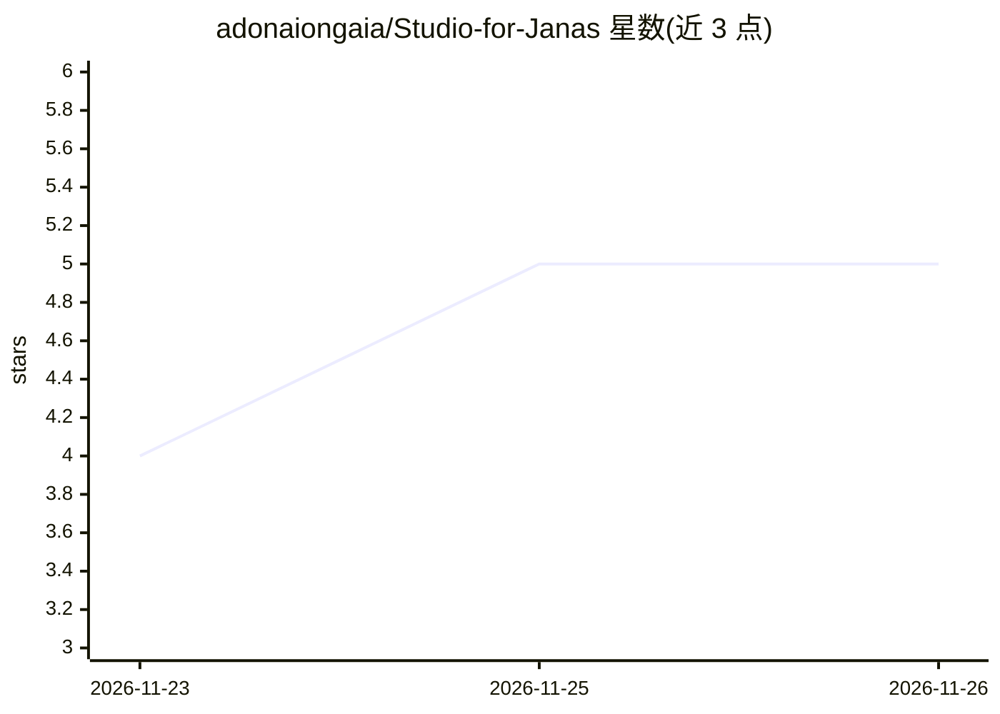

# adonaiongaia/Studio-for-Janas

⭐ 5 · Rust · GPL-3.0 · 推送 2026-11-25 · [GitHub](https://github.com/adonaiongaia/Studio-for-Janas) · 个人维护

**面向小型硬件的本地桌面 LLM 工作室，双引擎驱动推理与 Agent**

基于 Tauri 2/Rust/React 构建的本地 AI 桌面应用，作为 Janas-LLM 推理引擎的非官方独立客户端。它管理 janas-server 与 llama.cpp 两个推理引擎进程，提供 Agent 模式（工具调用循环）、本地文档库（BM25+TF-IDF 检索）、whisper.cpp 本地语音输入、分支聊天历史、MCP 工具作用域与崩溃安全存储。通过 SSD 流式技术可在内存小于模型容量的设备上运行大模型。AppImage 分发，无遥测，引擎经自动安装流程下载。

## 筛选速览

| 维度 | 判定 | 备注 |
|---|---|---|
| AI 角色 | `ai-native` | 本体是模型或模型工具 |
| 许可风险 | `viral` | GPL-3.0 |
| 部署形态 | `desktop` | 安装包/桌面程序 |
| 模型依赖 | local-ok | 支持本地模型 |
| 硬件要求 | — | 无带数字的原话,不猜 |
| 安装摩擦 | `high` | 编译与系统依赖俱全 |
| 成熟度 | — | 结构信号不足 |

## 能力要点

- 双推理引擎（Janas-LLM 与 llama.cpp）托管与自动安装
- 带审批策略、diff 预览与撤销的 Agent 工具循环
- 本地文档库混合检索与可点击引用
- whisper.cpp 本地语音输入，音频不上传

## 适用场景

- 在小内存设备上通过 SSD 流式运行大 GGUF 模型
- 在本地安全环境执行文件读写与命令的 Agent 任务
- 搭建完全本地、无遥测的私密聊天与语音输入工作台

## 场景标签

`AI 助手` · 领域:对话与助手

## 证据(README 行号)

> L3: **An independent, unofficial desktop studio for the Janas-LLM C inference engine.**
> L5: A local AI studio with **agent mode**, a local document vault, **local voice input**, branching chat history, per-ch
> L7: Studio for Janas is built with **Tauri 2**, **Rust**, **React 18**, **TypeScript**, and **Tailwind CSS**. It manages

## 星数曲线

2026-11-23 4 → 2026-11-26 5（+1）

---
*卡片 v1 · prompt 1.4 · 生成 2026-11-24 · 置信度 mid · 依据 README sha `85550bf6800a` · [字段定义](../../DATASET.md)*
