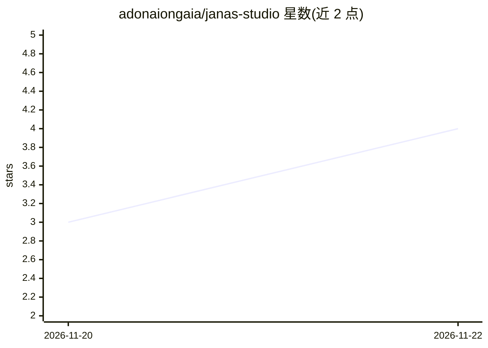

# adonaiongaia/janas-studio

⭐ — · [GitHub]() · 个人维护

**本地 LLM 桌面工作室：双引擎推理、Agent 模式与分支聊天**

基于 Tauri 2/Rust/React 的非官方 Janas-LLM 桌面前端，管理 janas-server 与 llama.cpp 两个本地推理引擎进程，将 OpenAI 兼容 SSE 流代理到 webview。提供 Agent 工具循环（工作区文件工具、审批策略、diff 预览、检查点撤销）、分支聊天历史、按聊天的 MCP 工具作用域、崩溃安全的 JSON 会话存储，以及涵盖 SSD 流式读、GPU/NPU 计数的系统遥测。Linux 提供未签名的 AppImage，首次运行自动下载引擎二进制，需网络访问。

## 筛选速览

| 维度 | 判定 | 备注 |
|---|---|---|
| AI 角色 | `ai-native` | 本体是模型或模型工具 |
| 许可风险 | `viral` | — |
| 部署形态 | `desktop` | 安装包/桌面程序 |
| 模型依赖 | local-ok | 支持本地模型 |
| 硬件要求 | — | 无带数字的原话,不猜 |
| 安装摩擦 | `high` | 编译与系统依赖俱全 |
| 成熟度 | — | 结构信号不足 |

## 能力要点

- janas-server 与 llama.cpp 双引擎后端，.gguf 与 .jns 模型分别加载，支持在 Compiler 中转换
- Agent 模式：Think→Act→Observe 循环、风险分级审批、diff 预览与整轮撤销
- 分支聊天与逐聊天工作区/MCP 作用域，JSON 文件原子写入与备份恢复
- 系统遥测：SSD 读写吞吐、RAM-vs-磁盘分层估算、存储瓶颈基准

## 适用场景

- 在本地桌面运行并管理 GGUF/JNS 格式的大语言模型
- 让模型在受限工作区内执行文件读写与命令并逐步审批
- 需要分支对话历史与可导入导出的会话存档
- 在无账号、无遥传的本地环境使用带 MCP 工具的助手

## 场景标签

`AI 助手` `聊天机器人` · 领域:对话与助手

## 证据(README 行号)

> L5: A local AI studio with **agent mode**, branching chat history, per-chat workspaces and MCP tool scopes, crash-safe s
> L7: Studio for Janas is built with **Tauri 2**, **Rust**, **React 18**, **TypeScript**, and **Tailwind CSS**. It manages
> L45: 2. **Let first-run setup finish.** The window opens immediately while the backend detects the CPU/GPU and downloads

## 星数曲线

2026-11-20 3 → 2026-11-22 4（+1）

---
*卡片 v1 · prompt 1.4 · 生成 2026-11-22 · 置信度 mid · 依据 README sha `ee5887b5feeb` · [字段定义](../../DATASET.md)*
