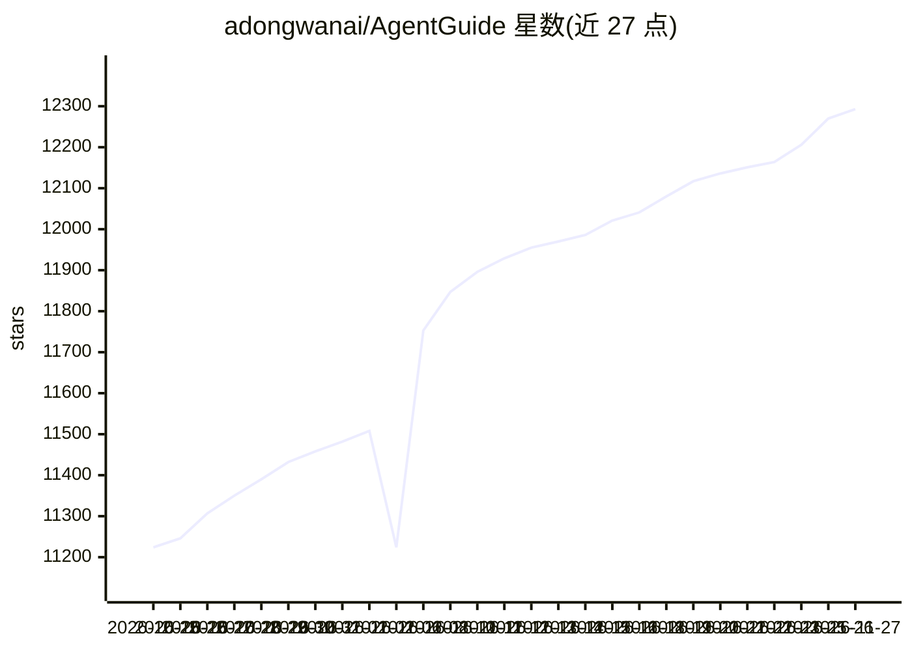

# adongwanai/AgentGuide

⭐ 12,293 · MDX · CC-BY-4.0 · 推送 2026-11-05 · [GitHub](https://github.com/adongwanai/AgentGuide) · [官网](https://adongwanai.github.io/AgentGuide/) · 个人维护 · 中文 README

**面向求职者的 AI Agent 开发学习指南与面试题库**

开源知识库，整合互联网已有的课程、教程与论文，将其串联为算法岗与开发岗两条学习路线（8-12/10-15 周），内容覆盖 Agent Harness、上下文工程、RAG、MCP/Skills、评测观测与 Agentic RL 等专题，配套面试题库、8 阶段学习产出清单与项目落地 5 步法；每个知识点标注面试考察方式与简历写法。作者自述为一线大模型算法工程师，内容以文档导航与资源链接为主，不绑定单一框架。

## 筛选速览

| 维度 | 判定 | 备注 |
|---|---|---|
| AI 角色 | `ai-knowledge` | 知识聚合/清单类 |
| 许可风险 | `viral` | CC-BY-4.0 |
| 部署形态 | `None` |  |
| 模型依赖 | — | README 未给出锁定关系 |
| 硬件要求 | — | 无带数字的原话,不猜 |
| 安装摩擦 | `medium` | 含编译或系统依赖之一 |
| 成熟度 | — | 结构信号不足 |

## 能力要点

- 算法岗/开发岗双路线学习路径与岗位选择决策树
- 8 阶段学习产出与项目落地 5 步法的执行清单
- 1-2-5 求职框架与简历三维表达法
- 整合 LangGraph、MCP、Agentic RAG、GRPO 等专题教程资源

## 适用场景

- 转行大模型方向时按路线系统学习 Agent 开发
- 准备算法岗或开发岗的 Agent 方向面试
- 为简历挑选并落地可复现的 Agent 实战项目

## 场景标签

`教程课程` · 领域:学习与行业

## 证据(README 行号)

> L85: > **AI Agent 工程、研究与求职的开源知识库**
> L22: > **📌 本项目定位：资源整合 + 系统化路径 + 实战导向**
> L27: > - ✅ **提供系统化路径** - 将碎片化资源串联成完整学习路线，告诉你先学什么、再学什么

## 星数曲线

2026-10-25 11,224 → 2026-11-27 12,293（+1,069）

---
*卡片 v1 · prompt 1.4 · 生成 2026-11-22 · 置信度 high · 依据 README sha `f90f24ad43f1` · [字段定义](../../DATASET.md)*
