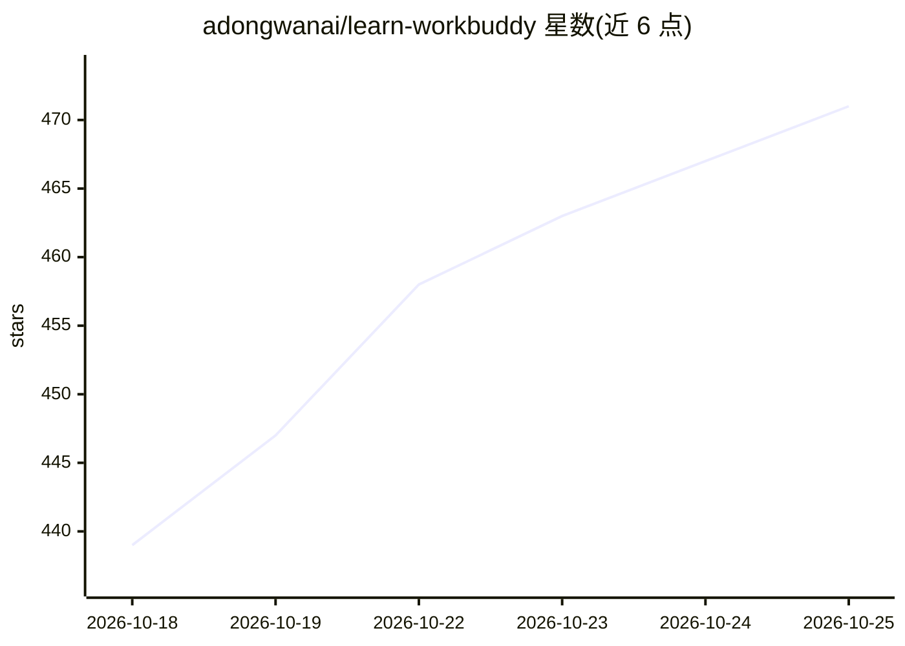

# adongwanai/learn-workbuddy

⭐ 472 · Python · MIT · 推送 2026-10-25 · [GitHub](https://github.com/adongwanai/learn-workbuddy) · 个人维护 · 中文 README

**24 章 Python 教程：从零复刻桌面 AI 助手 Harness 架构**

面向想理解桌面 Agent 工程的开发者教学仓库：24 章原创 Python 代码，每章一个机制，覆盖 Agent Loop、工具调用与延迟加载、权限 hook、Electron 分层、Sidecar、会话管理、五层记忆系统、上下文压缩、MCP、SQLite、自动化调度与 hash chain 审计沙盒；另含标准库实现的 Mini WorkBuddy 最小 harness（含 REST/JSON-RPC server 与多 Provider 适配层）。支持 DeepSeek/Anthropic/OpenAI 多 Provider，多数章节可无 key 离线运行；声明 clean-room 边界，不含 WorkBuddy 闭源代码。

## 筛选速览

| 维度 | 判定 | 备注 |
|---|---|---|
| AI 角色 | `ai-knowledge` | 知识聚合/清单类 |
| 许可风险 | `permissive` | MIT |
| 部署形态 | `library` | 以包/库形式分发 |
| 模型依赖 | locked-api |  |
| 硬件要求 | — | 无带数字的原话,不猜 |
| 安装摩擦 | `low` | 无编译、无系统依赖或容器化 |
| 成熟度 | — | 结构信号不足 |

## 能力要点

- 24 章渐进式课程，每章一份 code.py 与配图
- Mini WorkBuddy 最小 harness：agent loop、权限 guard、JSONL transcript、hash chain 审计、REST/ACP-like server
- Provider Adapter 归一化 DeepSeek/Anthropic/OpenAI/OpenAI-compatible 网关的调用形状
- 无 API key 可离线跑全部 demo，scripts/verify.py 覆盖语法/pytest/demo/脱敏扫描

## 适用场景

- 系统学习桌面 Agent 的 harness 架构（sidecar、记忆、审计、上下文管理）
- 参照章节代码动手实现自己的 Agent 运行时
- 用 DeepSeek/OpenAI 跑统一 --eval 入口生成模型评测轨迹

## 场景标签

`教程课程` · 领域:学习与行业

## 证据(README 行号)

> L4: **一份开源教学蓝图 — 不是产品源码，是可以跑的 Agent 工程课。**
> L18:  📚 24章 从 agent loop 到审计沙盒
> L38: **这个仓库把这些问题拆成 24 课。每一课只新增一个机制，每一课都有一份 `code.py` 和一张图。**

## 星数曲线

2026-10-18 439 → 2026-10-25 471（+32）

---
*卡片 v1 · prompt 1.4 · 生成 2026-10-21 · 置信度 mid · 依据 README sha `e4508a438c50` · [字段定义](../../DATASET.md)*
