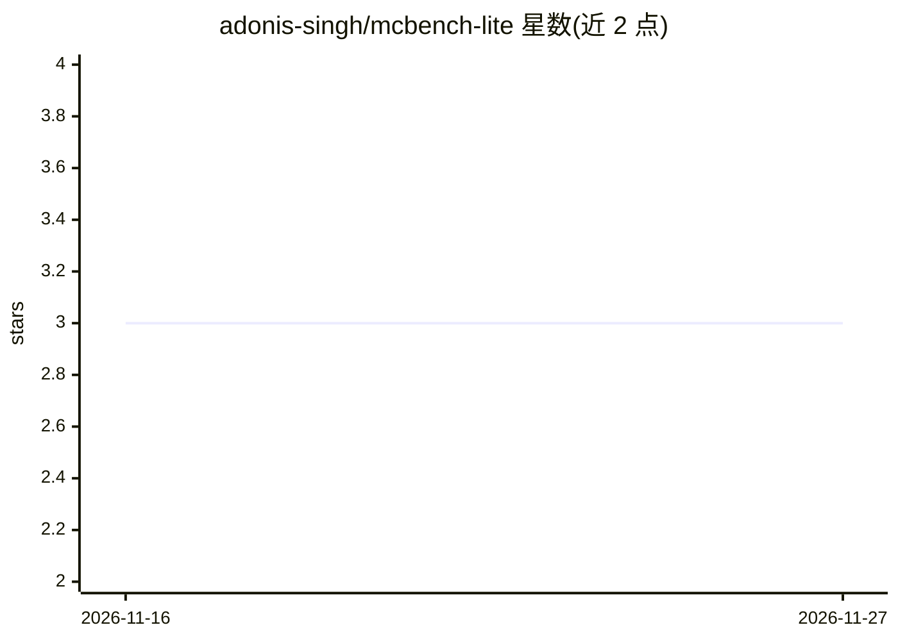

# adonis-singh/mcbench-lite

⭐ 3 · Rust · MIT · 推送 2026-11-26 · [GitHub](https://github.com/adonis-singh/mcbench-lite) · 个人维护

**让 AI 模型以 Agent 方式在 Minecraft 世界中搭建并横向对比的本地应用**

本地运行的网页/桌面应用：左侧对话，右侧 3D 体素查看器实时呈现模型在 Minecraft 世界中的搭建结果，追问会修改同一世界。模型以 Agent 形式工作，配备 build/see_build/test_build/bash 四个工具循环执行直至完成。Bench 模式将同一提示发给多个模型供用户投票比较。核心引擎是 Minecraft 1.21.10 方块更新逻辑的 Rust 复实现（红石、活塞、漏斗等），不模拟生物、随机刻与昼夜。2.0 起提供 macOS/Windows/Linux 原生安装包，网页版经 install 脚本或源码克隆运行。

## 筛选速览

| 维度 | 判定 | 备注 |
|---|---|---|
| AI 角色 | `ai-ecosystem` | LLM/agent 周边工具 |
| 许可风险 | `permissive` | MIT |
| 部署形态 | `self-host` | docker 或自建部署 |
| 模型依赖 | — | README 未给出锁定关系 |
| 硬件要求 | — | 无带数字的原话,不猜 |
| 安装摩擦 | `low` | 无编译、无系统依赖或容器化 |
| 成熟度 | — | 结构信号不足 |

## 能力要点

- 模型以 Agent 循环使用 build/see_build/test_build/bash 四个工具搭建并自检
- Rust 复实现的 Minecraft 1.21.10 引擎，未移植行为明确报 unported 而非近似
- Bench 模式一次提示发给多个模型并投票比较
- 无托管版本、无遥测，模型与接入通道由用户自行连接

## 适用场景

- 对比多个模型在同一搭建提示下的实际表现并投票
- 观察模型在可看、可测环境中的多轮 Agent 行为
- 本地离线运行红石/活塞等方块行为的搭建测试

## 场景标签

`模型评测` · 领域:评测与运维

## 证据(README 行号)

> L3: A local web app in which AI models build in Minecraft. You chat with a model, it builds in a Minecraft world shown i
> L9: ## How it differs from MC-Bench
> L11: In MC-Bench a model gets a prompt and writes one program in a single response, and the result is what people vote o

## 星数曲线

2026-11-16 3 → 2026-11-27 3（+0）

---
*卡片 v1 · prompt 1.4 · 生成 2026-11-22 · 置信度 mid · 依据 README sha `bfddfbc4cae4` · [字段定义](../../DATASET.md)*
