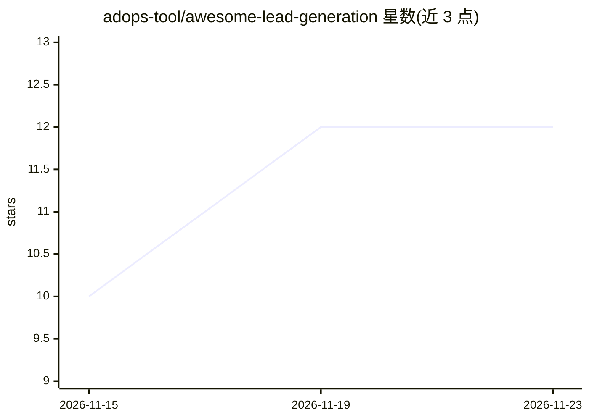

# adops-tool/awesome-lead-generation

⭐ 12 · Python · CC0-1.0 · 推送 2026-11-20 · [GitHub](https://github.com/adops-tool/awesome-lead-generation) · [官网](https://adops-tool.github.io/awesome-lead-generation/) · 个人维护

**面向销售增长的 AI 线索生成工具策展目录**

一个按线索生成流程组织的工具清单：从意图信号监测、数据抓取与富化，到冷启动外联和 CRM 管理，收录以 GitHub 开源项目和 SaaS 服务为主的条目，每条附一句话功能描述与来源类型标注。README 声明目标是记录 Modern Growth Stack，社区可通过 PR 贡献新条目。定位为目录/清单，不含自身代码或安装方式，采用 awesome-list 常见格式并带 CI 链接检查。

## 筛选速览

| 维度 | 判定 | 备注 |
|---|---|---|
| AI 角色 | `ai-knowledge` | 知识聚合/清单类 |
| 许可风险 | `viral` | CC0-1.0 |
| 部署形态 | `None` |  |
| 模型依赖 | — | README 未给出锁定关系 |
| 硬件要求 | — | 无带数字的原话,不猜 |
| 安装摩擦 | `low` | 无编译、无系统依赖或容器化 |
| 成熟度 | — | 结构信号不足 |

## 能力要点

- 按 find signals → enrich → outreach → CRM 流程组织条目
- 混合收录开源工具（github 标注）与商业服务（web 标注）
- 标注 MCP 服务器兼容的多款数据 API 工具

## 适用场景

- 找监测 Reddit/Twitter 高意向线索的工具
- 为 B2B 销售流程选型数据富化与外联工具
- 查找无需官方 API key 的社交平台采集库

## 场景标签

`精选清单` · 领域:学习与行业

## 证据(README 行号)

> L5: A curated list of the best AI-powered tools for Lead Generation, Social Listening, Data Enrichment, and Automated Ou
> L7: The goal of this repository is to document the **Modern Growth Stack**, moving away from static databases and toward

## 星数曲线

2026-11-15 10 → 2026-11-23 12（+2）

---
*卡片 v1 · prompt 1.4 · 生成 2026-11-19 · 置信度 high · 依据 README sha `a66dce3cd3b4` · [字段定义](../../DATASET.md)*
