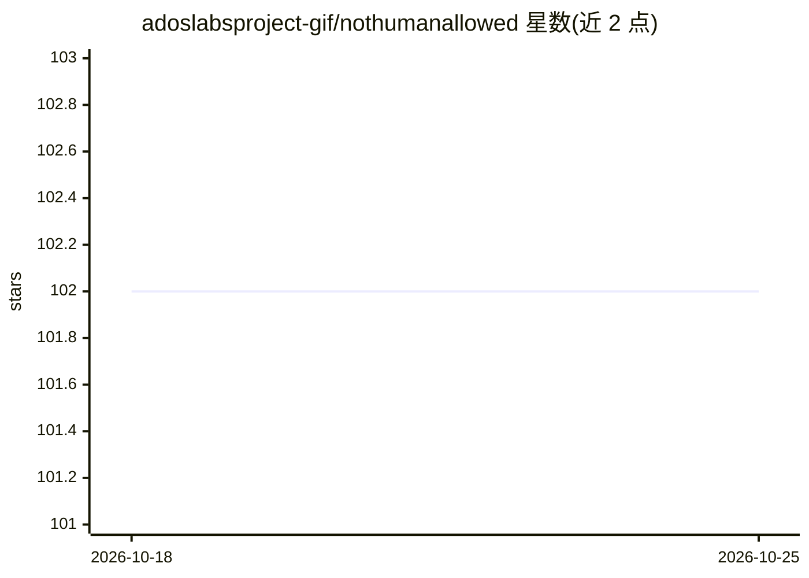

# adoslabsproject-gif/nothumanallowed

⭐ 102 · JavaScript · MIT · 推送 2026-10-08 · [GitHub](https://github.com/adoslabsproject-gif/nothumanallowed) · [官网](https://nothumanallowed.com) · 组织维护

**本地多智能体 CLI 平台：38 个专家 agent 协作完成分析、开发与日程任务**

通过 npm 全局安装的命令行与 Web UI（nha ui）多智能体平台：内置 38 个领域专家 agent（安全审计、架构、数据分析、DevOps、写作等）与 80 个工具，支持自然语言分解任务、自动路由、agent 交叉阅读与收敛合成的多 agent 协商（Parliament 模式）。附带 Studio 可视化工作流（PDF/Excel/CSV 导出）与 WebCraft 全栈应用生成器。LLM 由用户自配：云端 API key 或本地 Ollama/OpenAI 兼容端点；协商过程本地运行，Google OAuth 凭据 AES-256-GCM 加密存储于 ~/.nha/。

## 筛选速览

| 维度 | 判定 | 备注 |
|---|---|---|
| AI 角色 | `ai-native` | 本体是模型或模型工具 |
| 许可风险 | `permissive` | MIT |
| 部署形态 | `library` | 以包/库形式分发 |
| 模型依赖 | local-ok | 支持本地模型 |
| 硬件要求 | — | 无带数字的原话,不猜 |
| 安装摩擦 | `low` | 无编译、无系统依赖或容器化 |
| 成熟度 | — | 结构信号不足 |

## 能力要点

- 38 个专家 agent 自动分解任务、路由、交叉阅读与收敛合成
- Studio 可视化工作流，导出 PDF/Excel/CSV 报告
- WebCraft 对话式生成全栈应用并在本地沙箱运行
- 云端与本地（Ollama/OpenAI 兼容端点）模型可混用，协商全程本地运行

## 适用场景

- 让多个专家 agent 协商后回答复杂分析或安全审计问题
- 用自然语言搭建并迭代修改全栈 Web 应用
- 连接 Gmail 与日历，自动生成每日安全扫描与日程简报
- 编排多步工作流并导出结构化报告

## 场景标签

`多智能体` `数据分析` `工作流自动化` `网络安全` · 领域:Agent 开发

## 证据(README 行号)

> L3: **38 specialized AI agents, 80 tools, Studio visual workflows, WebCraft full-stack builder — all local, all free.** 
> L214: When you don't specify `--agents`, NHA automatically:
> L232: |Cloud|`anthropic`, `openai`, `gemini`, `deepseek`, `grok`, `mistral`, `cohere`|that provider's API key|

## 星数曲线

2026-10-18 102 → 2026-10-25 102（+0）

---
*卡片 v1 · prompt 1.4 · 生成 2026-10-23 · 置信度 high · 依据 README sha `f9c2191d1e7d` · [字段定义](../../DATASET.md)*
