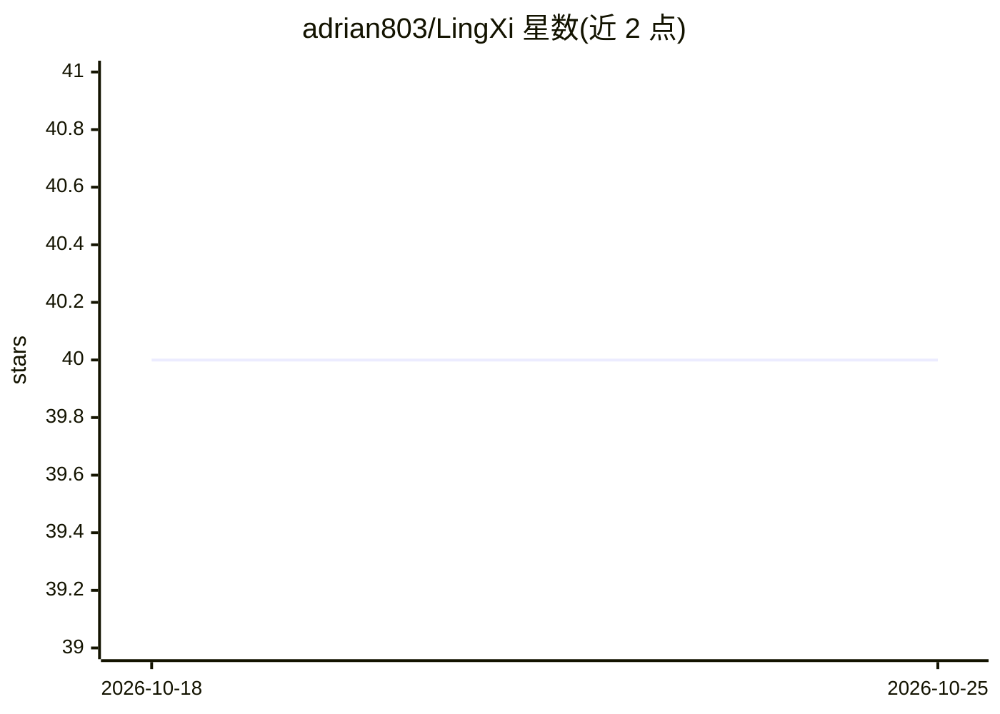

# adrian803/LingXi

⭐ 40 · Python · GPL-3.0 · 推送 2026-04-30 · [GitHub](https://github.com/adrian803/LingXi) · 个人维护 · 中文 README

**源自腾讯安全 Hackathon 的 LLM 多 Agent CTF/渗透测试框架**

LLM 驱动的自主渗透测试 Agent 框架，围绕拉题、侦察、工具执行、策略纠偏、Flag 提交与经验沉淀的闭环设计，采用 Main Agent / Advisor / Reflector 双 Agent 协作模型。技术栈为 Claude Code SDK + LangChain 编排、FastAPI + SSE Web Dashboard、Milvus Lite / Qdrant 向量检索、MCP 工具桥接，支持 DeepSeek / Anthropic / OpenAI / SiliconFlow 多 Provider 与自动 Failover。核心开源、私有扩展（论坛 / PoC / Sliver）默认关闭，未配置平台地址时进入待命模式。面向 CTF 选手与渗透测试开发者，需 Python 3.11+ 与至少一组 LLM API Key，Docker / Kali 可选。

## 筛选速览

| 维度 | 判定 | 备注 |
|---|---|---|
| AI 角色 | `ai-native` | 本体是模型或模型工具 |
| 许可风险 | `viral` | GPL-3.0 |
| 部署形态 | `self-host` | docker 或自建部署 |
| 模型依赖 | locked-api |  |
| 硬件要求 | — | 无带数字的原话,不猜 |
| 安装摩擦 | `low` | 无编译、无系统依赖或容器化 |
| 成熟度 | — | 结构信号不足 |

## 能力要点

- Main Agent / Advisor / Reflector 双 Agent 协作与策略纠偏
- DeepSeek / Anthropic / OpenAI / SiliconFlow 多 Provider 适配与自动 Failover
- 分层知识系统：运行记忆、结构化经验与 CTF Writeup 向量检索
- FastAPI + SSE 实时 Web Dashboard 与 MCP 工具桥接

## 适用场景

- CTF 比赛中自动拉题、侦察、利用与提交 Flag
- 搭建 LLM 驱动的渗透辅助工作流并接入 Kali 工具链
- 通过 Dashboard 观察、控制与分析多 Agent 任务执行

## 场景标签

`Agent 框架` `多智能体` `网络安全` · 领域:Agent 开发

## 证据(README 行号)

> L21: 源自腾讯安全 Hackathon「智能渗透主战场 / 零界论坛赛道」的 LLM 驱动多 Agent 渗透辅助框架
> L27: LingXi 是一个 LLM 驱动的自主渗透测试 Agent 框架，围绕"自动拉题 / 侦察 / 工具执行 / 策略纠偏 / Flag 提交 / 经验沉淀"的闭环设计，源自腾讯安全 Hackathon 比赛项目。

## 星数曲线

2026-10-18 40 → 2026-10-25 40（+0）

---
*卡片 v1 · prompt 1.4 · 生成 2026-10-25 · 置信度 mid · 依据 README sha `e1023ec646c9` · [字段定义](../../DATASET.md)*
